# State machines

Each entity below is owned by one Durable Object, which is its source of truth. Every transition commits the new state and its event (see [events.md](events.md)) in one `transactionSync`. A transition is triggered by a **command** (an API call, or a Workflow step calling the owning DO) or by **another entity's event**, in which case the new event's `causation` names it. When one command drives two transitions (a change bounced while its lease has lapsed), both events commit in the same transaction.

Each machine reaches **exactly one terminal state** per run, and replaying an entity's events in `seq` order rebuilds its state exactly. Both properties are property-tested in the domain tier.

Terms are in [CONTEXT.md](../../CONTEXT.md).

## Ownership

| Entity | Owning DO | DO key |
|---|---|---|
| agent | AgentSession DO | `agent:<agentId>` |
| session | AgentSession DO | `agent:<agentId>` |
| change (and its lease) | Change DO | `change:<ULID>` |
| subject | Subject DO; the subject registry (keys, aliases, anchors) is in the Project DO | `subj:<project>:<key>` |
| project | Project DO | `project:<projectId>` |
| sketch | WorkspacePool DO | `pool:<project>` |
| workspace | WorkspacePool DO | `pool:<project>` |
| conflict | Subject DO for `semantic` and `precedent`; Lane DO for `textual` and `interaction` | `subj:…` / `lane:<project>:<id>` |
| probe | the DO that owns its conflict | as its conflict |
| guard | the DO that owns the conflict it proved | as its conflict |
| batch | Lane DO | `lane:<project>:<id>` |
| trunk (promotion) | Trunk DO | `trunk:<projectId>`: its own entity kind and seq, apart from the project's |
| candidate | Lane DO | `lane:<project>:<id>` |
| verdict | the DO that issued it: Change DO for a change, Lane DO for a batch | as its issuer |
| decision | the namespace object that took the ruling, in the ruling's own transaction | `ns:<namespaceId>` |
| tenet | Subject DO | `subj:<project>:<key>` |
| escalation | the object of the namespace that owns its project | `ns:<namespaceId>` |
| deployment | the DO that created it | as its creator |
| user | none: D1 (Better Auth) holds it; its tenancy events are committed for the audit | `user:<userId>` |
| org | none: D1 (Better Auth) holds it; its tenancy events are committed to the org's object | `org:<orgId>` |

D1 holds projections only (the catalog, and `AgentDirectory`'s client-credential index). No decision reads K2 or D1.

---

## Change

Owner: Change DO.

**Agent-owned states** are Declared, Working, Drifted and Bounced: the change waits on its agent. In every other non-terminal state the platform owns it.

<!-- chart:change — generated from packages/core/test/charts/charts.ts by render.ts; edit the chart, not this block -->
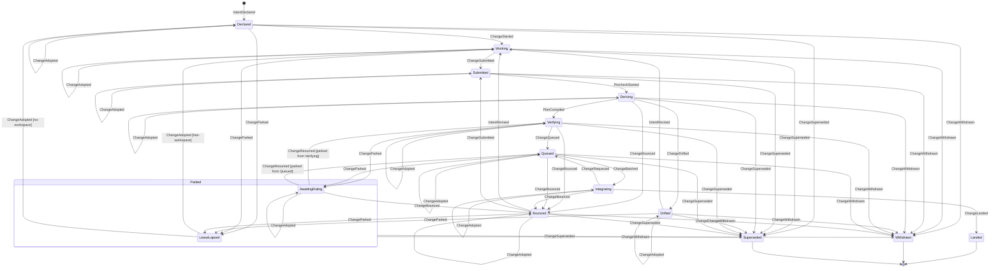
<!-- /chart:change -->

| From | To | Trigger | Guard | Event |
|---|---|---|---|---|
| — | Declared | `declare` (or `declare --from-sketch`), or the Auditor declaring a revert | Scope `agent:work` for agents | `IntentDeclared {origin}` (lease issued), then `PreflightIssued`. Every proposition is committed in canonical form (`canonicalProposition`: an ordering is written from its lesser event), as are a revision's, a relied premise and the derived effects |
| Declared | Working | The pool grants a workspace, or the promoted sketch's workspace is reassigned | — | `ChangeStarted` (caused by `WorkspaceGranted` or `SketchPromoted`) |
| Working | Working | `revise` / `rely` | Valid lease; `If-Match` on the current revision (`revise`) | `IntentRevised`, then `PreflightIssued`. A `rely` is a revision that adds one premise; the Subject DO answers it with its own `PremiseRelied` |
| Working, Bounced | Submitted | `submit {changeId, commitSha}` | Valid lease; the commit is in the change's workspace | `ChangeSubmitted`, carrying the change's base: the base Precheck judges the submission against |
| Working, Bounced | the same state | `rebase {from, onto}`: the agent rebased its workspace (after a textual bounce, say) | Valid lease; `from` is the change's base and `onto` another commit; otherwise refused, with a read of the change | `ChangeRebased {from, to}`: the base moves, and nothing else changes |
| Submitted | Deriving | Precheck instance created | — | `PrecheckStarted` |
| Deriving | Bounced | Precheck: a protected or guard path is touched | — | `ChangeBounced` |
| Deriving | Drifted | Precheck: drift needs the agent (an undeclared proof-class effect) | — | `ChangeDrifted` |
| Deriving | Deriving | Precheck: the submitted commit's effects are derived | Once per Precheck pass: a second in the same pass is refused, with a read of the change. The next pass (a resubmitted commit, even at the same revision) derives again | `EffectsDerived`, alone: a fact that leaves the change Deriving, committed before the drift and the plan |
| Deriving | Verifying | Precheck: drift classified, plan compiled | — | `DriftDetected`, then `PlanCompiled` |
| Drifted, Bounced | Working | `revise` | Valid lease | `IntentRevised` |
| Verifying | Queued | The plan's pre-queue steps pass | No Proven conflict is open, no guard fails, no high-severity drift is unresolved; otherwise the command is refused as blocked, with no event | `ChangeQueued`, carrying the hash of the plan the change was compiled to (as does `ChangeRequeued`) |
| Verifying | Bounced | A conflict is proven against the change under a `block` policy, or a guard fails | — | `ChangeBounced`, naming exactly one cause: the verdict, or the conflict (a conflict bounces a change only from Deriving, Verifying or Queued) |
| Verifying, Queued | Parked | A conflict the change is a party to is put to a person (caused by `ConflictEscalated`), or one already is when the change is queued: `ChangeParked` then follows `ChangeQueued` in the same commit | — | `ChangeParked {reason: awaiting-ruling}`. The change keeps its lane and its plan; its lane takes it out of the queue, so no batch forms with it. A change already Integrating is not parked: it finishes its batch |
| Queued | Integrating | Caused by `BatchFormed` | Nothing blocks it, as for queueing; a blocked change refuses the batch and is bounced. And no person has yet to rule on one of its conflicts: a change that waits for a ruling refuses the batch too, naming the escalations and saying to wait, and stays Queued | `ChangeBatched` |
| Queued | Bounced | A conflict is proven against the change (caused by `ConflictProven`), or it is blocked when batched | — | `ChangeBounced` |
| Integrating | Queued | Caused by `BatchFailed` blaming another member, `infra`, `textual` or `interaction`; by `CandidateBisected`; or by `CandidateInvalidated` | The domain's `redExit` reads the cause from the attribution. Two infra failures requeue with no blame. A member requeued for `textual` or `interaction` runs alone in its next batch (`runsAlone`), so a clash between members ends in one landing and one sole-member failure | `ChangeRequeued {reason}`: `co-member-failed`, `infra-failure`, `textual`, `interaction`, `bisection` or `invalidated` |
| Integrating | Bounced | Caused by `BatchFailed` attributed to this change | — | `ChangeBounced` |
| Integrating | Bounced | Caused by `PromotionDeclined` for a refused push that bounces its members: a pack too large for a batch promoted alone, or a repo at its size quota | The declined batch is the change's own | `ChangeBounced {declined: {batchId, reason}}`, with the way forward for the reason: split the change, or have room made and submit again |
| Integrating | Landed | Caused by `TrunkAdvanced` | None: `TrunkAdvanced` is a fact, so landing is never refused. The invariant is enforced before trunk moves: at queueing, by Queued → Bounced, and by the lane pulling a blocked member out before promotion (`CandidateInvalidated`, then `ChangeRequeued {reason: invalidated}`) | `ChangeLanded`, copied from the change's landing in `TrunkAdvanced`: its commit on trunk, the trunk head, its candidate and its proof |
| Parked (awaiting-ruling) | Verifying or Queued: the state it was parked from | The escalation it waits for is ruled on (caused by the `ConflictResolved` that carries the ruling's decision) | The decision is that escalation's; another conflict's leaves it parked | `ChangeResumed`. Back in Queued it rejoins its lane at the front, under the plan it was queued with |
| Parked (awaiting-ruling) | Bounced | Caused by `RulingGiven` choosing to bounce | — | `ChangeBounced` |
| Parked (lease-lapsed) | Working | `adopt` | The lease is Lapsed | `ChangeAdopted` (new lease; the old token is fenced). A change parked before its workspace was granted returns to Declared |
| any other non-terminal state | the same state | `adopt` | The lease is Lapsed | `ChangeAdopted`: the change keeps waiting (e.g. Parked awaiting-ruling, Verifying), now with the new lease |
| an agent-owned state | Parked (lease-lapsed) | The lease's deadline alarm | The lease lapsed: 15 minutes since `renewedAt` | `LeaseLapsed`, then `ChangeParked {reason: lease-lapsed}` |
| a platform-owned state | an agent-owned state, with a Lapsed lease | Any transition into Bounced, Drifted, or Working after a ruling | The lease lapsed while the platform owned the change | that transition's event, then `ChangeParked {reason: lease-lapsed}` in the same transaction |
| any non-terminal state | the same state | A conflict is proven against the change under an `advise` or `annotate` policy | — | `ConflictNoted {policy}`: nothing moves. Under `advise` it names the ways forward (read the conflict, revise, resolve); under `annotate` it notifies no one |
| any but Integrating and terminal | Withdrawn | `abandon` | Valid lease, or scope `operator` | `ChangeWithdrawn` |
| any but Integrating and terminal | Superseded | A ruling chooses an alternative; or, by policy, an alternative that retracts a tenet loses automatically when the winner lands | — | `ChangeSuperseded` (caused by `RulingGiven` or by the winner's `ChangeLanded`) |

**Terminal:** Landed, Withdrawn, Superseded.

**Invariants and properties**
- Trunk advances only through the Trunk DO; no agent ever holds a trunk token.
- A change cannot land with an open Proven conflict, a failing guard, or unresolved high-severity drift. Landing records a fact and is never refused, so this is enforced earlier: a blocked change is never queued, and never batched (it is bounced from Queued instead).
- **No batch past a question a person was asked:** a change enters no batch while one of its conflicts is with a person and not yet ruled on. The Change DO hands the machine those escalations with its blockers, and the batch is refused whatever the change did or did not hear of them: a second escalation raised while it was parked for the first, or one raised while it was in a batch that then failed and requeued it. An awaited ruling never stops the queueing itself: the change is queued and parked in the same commit, so its resume finds it in its lane. (Property-tested.) **Known edge:** a change already Integrating when its conflict is escalated is not parked and finishes its batch, so it can land before the ruling.
- **A resumed change is the change that was parked:** it is back in the state it was parked from, in its lane and under its plan, and only its lease may have moved while it waited. (Property-tested against the harness's own record of where it was parked, not the change's.)
- Effects used in any verdict are derived by Keel, never taken from the agent.
- A lapse parks only agent-owned states. In Integrating the change belongs to its batch, so withdrawal waits until the batch resolves.
- **No orphaned change:** for every event sequence, a change in an agent-owned state has an Active lease or is Parked. (Property-tested: a lease lapsing in any platform-owned state, followed by any transition into an agent-owned state, ends Parked.)
- Every landed change has an Intent revision, a Session link and a Verdict with evidence.

---

## Lease

Owner: Change DO. A Lease is a permit to act on a Change, carrying a server-minted fencing token (`lse_…`). It is never exclusive over files.

<!-- chart:lease — generated from packages/core/test/charts/charts.ts by render.ts; edit the chart, not this block -->
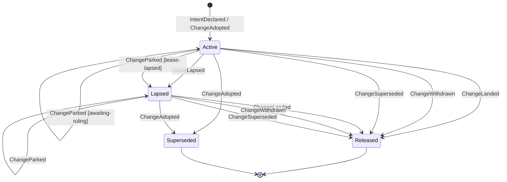
<!-- /chart:lease -->

| From | To | Trigger | Guard | Event |
|---|---|---|---|---|
| — | Active | `declare` or `adopt` | — | `IntentDeclared` / `ChangeAdopted` carry the `leaseId` |
| Active | Active | Any MCP or REST call on the change, or the agent's hook | The call carries this `leaseId` | none: `renewedAt` is state, not an event |
| Active | Lapsed | The deadline alarm at `renewedAt + 15 min` | No renewal since | `LeaseLapsed` |
| Lapsed | Superseded | `adopt` by any agent with scope `agent:work` | — | `ChangeAdopted` (the new lease's token fences the old) |
| Active, Lapsed | Released | The change lands, is withdrawn or is superseded (e.g. an operator withdraws a parked change) | — | the change's terminal event |

**Terminal:** Released, Superseded.

**Invariants**
- Every mutating call on a change carries its `leaseId`; a call with a stale token is refused with next actions. "No lease" is never permission. Once the deadline passes, the current token is refused too (as lapsed, with adoption as the next action), whether or not the alarm has fired.
- Every refusal and every bounce carries at least one next action.
- Whether a lease has lapsed is computed on read, from `renewedAt` and the time passed in; the alarm only makes the lapse visible as an event. It is a deadline, never a polling loop, and it is re-armed only while the lease is Active.
- `renewedAt` is state the Change DO persists, not an event, so a replay rebuilds every other field exactly and gives the lease's issue time as `renewedAt`.
- Adoption is a lease operation: it is allowed whenever the lease is Lapsed, whatever the change is waiting on.

---

## Conflict

Owner: by kind. The Subject DO owns `semantic` and `precedent` conflicts. `textual` (a refused merge) and `interaction` (every subset of a batch passes, the union fails) conflicts have no subject, so the Lane DO owns them.

Footprint overlap is not a conflict: it is *exposure*, reported in preflight's neighbours. Proximity never opens a conflict.

<!-- chart:conflict — generated from packages/core/test/charts/charts.ts by render.ts; edit the chart, not this block -->
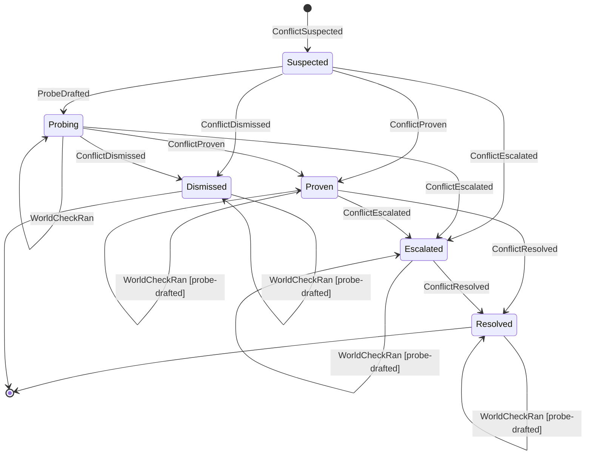
<!-- /chart:conflict -->

| From | To | Trigger | Guard | Event |
|---|---|---|---|---|
| — | Suspected | Fallout: a same-key contradiction with intersecting scope, or a silent retraction (semantic); a precedent's guard at risk (precedent); a refused merge (textual); a batch whose union fails while every subset passes (interaction) | Proximity alone never opens a conflict | `ConflictSuspected` |
| Suspected | Proven | Proof without a probe: a merge GitCore and MergeBox both refuse (textual), a failing guard (precedent), or a batch whose union fails while every subset passes (interaction) | The proof matches the kind | `ConflictProven` |
| Suspected | Dismissed | A deterministic lattice comparison shows the propositions are compatible (a ruling) | `decide` compares the premise and the effect itself: compatible or refines. Never for a conflict a decision model raised (`origin: opinion`), because a comparison over an opinion-derived effect is tainted, not a ruling | `ConflictDismissed` |
| Suspected | Probing | A probe compiles and runs | — | `ProbeDrafted` |
| Suspected | Escalated | Every draft fails (four at most), or the conflict names no premise and effect to probe: it is unprovable | The settle names the escalation it opened; without one it is refused (`escalation-required`). A settle that proves or dismisses needs none | `ProbeDiscarded {draft-failed}`, then `ConflictEscalated {reason: unprovable}` |
| Probing | Probing | One world-matrix cell completes | — | `ProbeRan` |
| Probing, or any state after it | The same state | A project suite's cell of the matrix (`suite:trunk` or `suite:<changeId>`, any world, run 1–3) completes. The suites are Tier 2 runs that finish minutes after the probe's deciding cell, so the cell is taken whatever the conflict has become since: Proven, Dismissed, Escalated or Resolved | The conflict's probe was drafted: before any draft, and on a conflict decided without a probe (a refused merge, a failing guard, a lattice ruling, drafts that all failed), it is refused (`no-probe-drafted`). The same cell again commits nothing; a different answer for it is refused; an n/a cell says why. It is evidence for people, never admission evidence: admission does not wait for it, and it never moves the conflict | `WorldCheckRan` |
| Probing | Proven | The probe discriminates | It passes on trunk (or does not apply), passes in the premise-holder's world, fails in the combined world and fails in A-noop, three runs in a row | `GuardAdmitted`, then `ConflictProven` |
| Probing | Dismissed | The probe gives the same answer in every world | — | `ProbeDiscarded {non-discriminating}`, then `ConflictDismissed` |
| Probing | Escalated | The probe is unstable across runs | The settle names the escalation it opened, as above | `ProbeDiscarded {unstable}`, then `ConflictEscalated {reason: unprovable}` |
| Proven | Escalated | The conflict is human-class | Permission semantics, destructive migrations, ambiguous requirements | `ConflictEscalated {reason: human-class}` |
| Proven | Resolved | A Move is applied (bounce, sequence, yield, merge, distinguish…) | — | `ConflictResolved` |
| Escalated | Resolved | Caused by `RulingGiven` | A Decision: an escalated conflict resolves only on a ruling | `ConflictResolved` (with `decisionId`) |

**Terminal:** Resolved, Dismissed. A terminal conflict whose probe was drafted still records a late suite cell: a fact that leaves it where it ended.

**Invariants**
- Only proof or a ruling moves a conflict to Proven or Dismissed. An unprovable conflict is opinion, and it escalates rather than blocking.
- A dismissal is recorded as evidence, so the same alarm is not raised again on the same facts.

---

## Probe → Guard

Owner: the DO that owns the probe's conflict. If a probe proves the disagreement it is admitted as a Guard in the guard repo, which agents cannot write to.

**A probe entity begins with its first event:** `ProbeDrafted` (a draft compiled and ran) or `ProbeDiscarded {draft-failed}` (every draft failed). Drafting and its bounded repair loop (≤ 4 attempts: the first draft and three repairs, driven by deterministic error text) are a phase inside one Workflow step, not a persisted state, so replay rebuilds a probe exactly from its events.

<!-- chart:probe — generated from packages/core/test/charts/charts.ts by render.ts; edit the chart, not this block -->
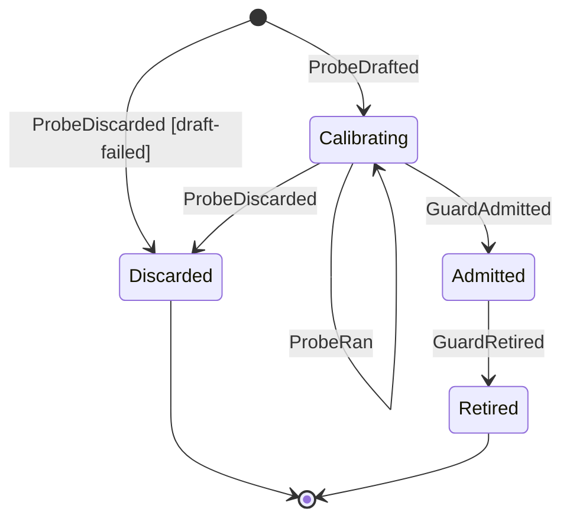
<!-- /chart:probe -->

| From | To | Trigger | Guard | Event |
|---|---|---|---|---|
| — | Calibrating | A draft compiles and runs | Attempts ≤ 4; the conflict names the premise at stake and the effect against it (else refused `no-propositions`: a probe is never guessed, so the drafter reports the draft failed) | `ProbeDrafted` |
| — | Discarded | Every draft failed, or there was nothing to draft against | — | `ProbeDiscarded {reason: draft-failed}` |
| Calibrating | Calibrating | One world-matrix cell (trunk, A, B, AB or A-noop; run 1–3) completes | Its conflict is Probing it. The same cell again is a retry and commits nothing; a different answer for it is refused | `ProbeRan` |
| Calibrating | Admitted | Computed from the `ProbeRan` cells | Passes on trunk (or does not apply), passes in the premise-holder's world, fails in the combined world, **fails in A-noop**, stable over 3 runs | `GuardAdmitted` |
| Calibrating | Discarded | Not discriminating, or unstable | — | `ProbeDiscarded` |
| Admitted | Retired | A superseding Decision | — | `GuardRetired` |

**Terminal:** Discarded, Retired. (An admitted Guard stays Admitted, guarding trunk, until a Decision retires it.)

**A-noop** is the premise-holder's world with the premised behaviour removed: for S-1's freshness template, a revoke route that answers 204 and removes nothing. The probe's template supplies the recipe for building it, and the world matrix builds it. A probe that passes there, or does not apply there, never tested the premise (spike S26 found one that only counted store lookups), so it is non-discriminating. A probe whose recipe cannot build an A-noop world never completes a run, so it is never admitted, and its conflict escalates as unprovable rather than resting on a possibly vacuous probe.

**Invariants**
- A drafted probe is opinion until it discriminates.
- Only guards block on behalf of past decisions; a change whose diff touches guard paths is refused at Precheck.
- A guard that turns unstable on trunk is escalated to a person, never quarantined automatically: protected checks are human-class.

---

## Candidate

Owner: Lane DO. A **Batch** is a set of Changes verified together; its **Candidate** is the tree composed for one attempt. They are one-to-one per attempt, so the batch events are the candidate's transitions. Promotion onto trunk belongs to the Trunk DO (below).

<!-- chart:candidate — generated from packages/core/test/charts/charts.ts by render.ts; edit the chart, not this block -->
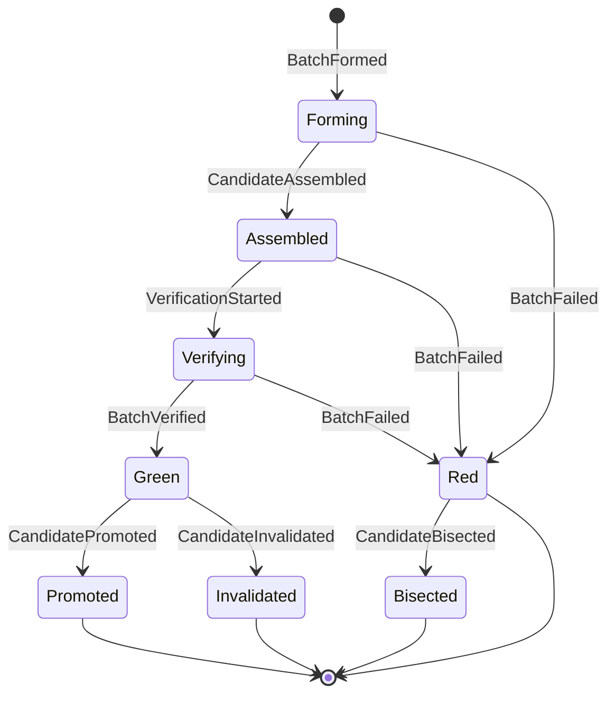
<!-- /chart:candidate -->

| From | To | Trigger | Guard | Event |
|---|---|---|---|---|
| — | Forming | The lane forms a batch | N = clamp(ln 0.8 / ln(1−p), 1, 16); no two members with an open suspected conflict or opposite effects on one subject; risky changes alone; speculation ≤ 4 deep | `BatchFormed` |
| Forming | Assembled | GitCore composes the tree (Tier 0), or MergeBox when GitCore refuses (Tier 2) | — | `CandidateAssembled` (with tier and reason) |
| Forming | Red | GitCore and MergeBox both refuse to compose | — | `BatchFailed`: for a batch of one, attributed to its member, so the change bounces with next actions; for a larger batch, `textual`: every member requeues and runs alone next, and the Lane opens no Conflict for it (a proven one would bounce the innocent member too) |
| Assembled | Verifying | KeelVerify instance created | — | `VerificationStarted` |
| Assembled | Red | The candidate cannot be bundled (a symlink, a gitlink, an unsafe path) | The blame is a member (the one whose restacked commit introduces the entry) or `infra` (the base already holds it) | `BatchFailed` with that attribution; never bisected |
| Verifying | Green | The union of the members' plans passes | Results fenced on `(batchId, attempt, chainEpoch)`: a result for another attempt or epoch is refused and never retried | `BatchVerified` (with the members, base and predecessors the Trunk DO needs) |
| Verifying | Red | A step fails after a flake rerun | Fenced as above; a blamed change is a member; `interaction` and `unattributed` need several members (a batch of one's failure is its member's) | `BatchFailed` (attribution: a change, `interaction`, `infra`, or `unattributed` when several members could be to blame) |
| Red | Bisected | More than one member, and the failure is `unattributed` | — | `CandidateBisected` (new batches) |
| Green | Promoted | Caused by `TrunkAdvanced` | — | `CandidatePromoted` |
| Green | Invalidated | Caused by `PromotionDeclined`: trunk moved and the commutation rule fails | — | `CandidateInvalidated` |

**Terminal:** Promoted, Invalidated, Bisected, Red (unless it is `unattributed` with several members, which is bisected).

**Invariants**
- An interaction failure (every subset passes, the union fails) opens an `interaction` conflict owned by the Lane DO.
- Every step records its tier and the reason it was chosen. An escalation to a higher tier is sticky and visible.

### Promotion (Trunk DO)

Owner: Trunk DO (`trunk:<project>`), the one writer of trunk ([ADR 0003](../adr/0003-trunk-single-writer-wal.md)).

<!-- chart:promotion — generated from packages/core/test/charts/charts.ts by render.ts; edit the chart, not this block -->
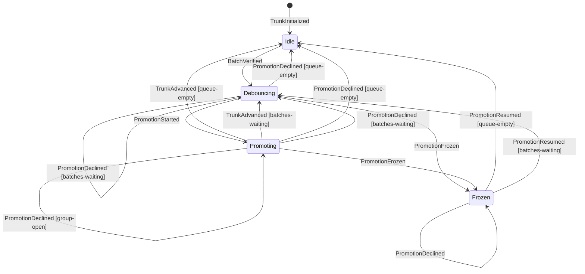
<!-- /chart:promotion -->

The Trunk DO's state is folded from its own events and from the `BatchVerified` it receives, recorded in the same transaction as its reaction ([ADR 0009](../adr/0009-event-driven-outbox.md)), so replaying both in commit order rebuilds it.

| From | To | Trigger | Guard | Event |
|---|---|---|---|---|
| — | Idle | The project's seed, or an operator, names trunk's first head | — | `TrunkInitialized {head}`. Before it, nothing is queued or promoted (refused: not initialized) |
| Idle | Debouncing | A `BatchVerified` arrives | — | the received `BatchVerified` is recorded; the debounce alarm is armed (a named debounce). In any other phase the batch only queues |
| Debouncing | Promoting | The debounce deadline fires | The observed head is trunk's known head; queued batches are taken first in, first out: one that commutes (C1–C6) joins the group, one that does not is declined, one that must wait stops the queue there | `PromotionDeclined` for each declined batch, then `PromotionStarted {old, members, batches, proofIds, committerTime}`: the WAL entry |
| Debouncing | Idle, or Debouncing | The commutation rule admits no batch | — | `PromotionDeclined` for each declined batch; Debouncing again while batches still wait |
| Debouncing | Frozen | The observed head is not trunk's known head | — | `PromotionFrozen {reason: head-moved}` |
| Promoting | Promoting | The group is composed, before the first push | The composer's chain names exactly the group's members, in group order (otherwise refused: composition mismatch) | `PromotionComposed {sha, commits}`: every retry pushes this SHA, and each member lands as its commit in `commits` |
| Promoting | Promoting | Read-back shows the head is still `old` | — | none: the push is retried with the recorded SHA. A recompose that differs from it is never pushed: `PromotionFrozen {reason: recompose-mismatch}` |
| Promoting | Idle, or Debouncing | Read-back shows the head is the recorded SHA | — | `TrunkAdvanced {landings}`: one per member, in group order, with its commit on trunk and its own batch's candidate and proof; Debouncing again if batches arrived meanwhile |
| Promoting | Frozen | Read-back shows any other head | — | `PromotionFrozen {reason: readback-mismatch}` |
| Promoting | Idle, or Debouncing | Artifacts refuses the group's push, or the composed pack would take the repo past its quota | The group is composed, and the head is still `old` (a push that may have landed is read back instead) | `PromotionDeclined {reason: pack-too-large or repo-bytes-quota, nextActions}` for each batch of the group, the last ending it; trunk does not move and never freezes. A batch refused alone as too large, and every batch of a full repo, has `reverify` empty: its members bounce. A group of several refused as too large names each batch's members in `reverify`, and from then on each group is one batch, until a push lands |
| Frozen | Idle, or Debouncing | An operator releases the freeze, confirming trunk's head | Scope `operator` | `PromotionDeclined {reason: frozen}` for each batch of the stopped group, then `PromotionResumed {head}` |

The Auditor's full-suite run on each new head is recorded as `AuditCompleted`. On red it bisects across commutation-promoted commits and declares a revert change with `origin: auditor`, which lands like any other change.

**Invariants**
- A retry pushes the SHA recorded in `PromotionComposed`, never a recompose: compose is deterministic only within one code version, and a Durable Object can run the previous version for minutes after a deploy.
- Every WAL group ends exactly once, in `TrunkAdvanced` or `PromotionFrozen`. Nothing promotes from Frozen until `PromotionResumed`.
- Artifacts' own compare-and-swap, if it exists, is a second fence and never the only one.

---

## Escalation

Owner: the object of the namespace that owns the project the question is about (`ns:<namespaceId>`), whoever raised it. Its id is derived from what it is about, so the same question raised again (a retry, the other party) is the same escalation. An Escalation is a question routed to a person, with options and their consequences.

<!-- chart:escalation — generated from packages/core/test/charts/charts.ts by render.ts; edit the chart, not this block -->
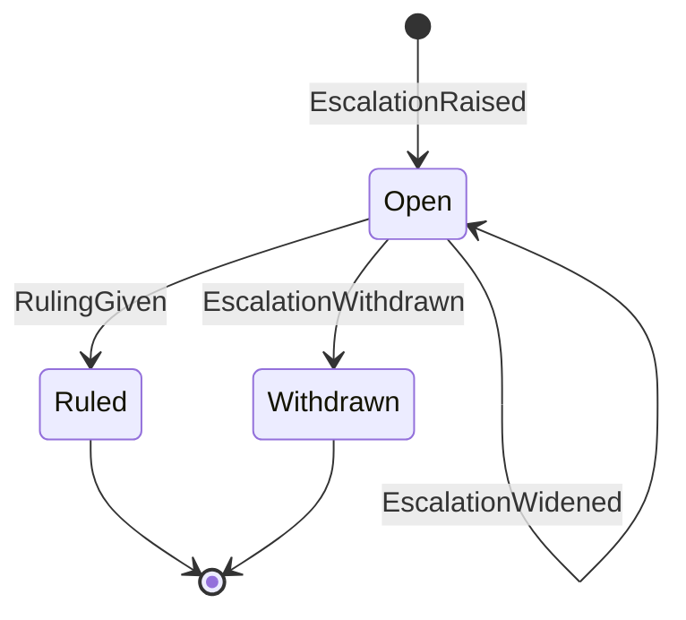
<!-- /chart:escalation -->

| From | To | Trigger | Guard | Event |
|---|---|---|---|---|
| — | Open | A human-class conflict or step, an unprovable conflict, an overrule request, a frozen trunk | At least two options with unique ids, and the default among them (otherwise invalid) | `EscalationRaised` |
| Open | Ruled | A person answers | Scope `operator`; the option is one the escalation offers (otherwise refused, with a next action per valid id) | `RulingGiven`, emitted by the owner, with the `DecisionRecorded` it makes in the same transaction. The object that raised the escalation hears the decision and acts on it (a conflict resolves with it, and its parked parties resume) |
| Open | Withdrawn | Its subject was resolved some other way | — | `EscalationWithdrawn` |
| Open | Open | The user asked first has had thirty minutes (the owner's own deadline) | Not widened before: a second widening commits nothing | `EscalationWidened`: the namespace's maintainers are asked too. The escalation records when (`widenedAt`); who may answer does not change |

**Terminal:** Ruled, Withdrawn: a second ruling, even an identical one, is refused (the doorway's idempotency key covers retries), and neither is widened. While Open the owner holds; the default is only a suggestion and is never applied on a timeout. A ruling produces a Decision.

---

## Decision

Owner: Subject DO. A Decision is a recorded ruling. Later changes meet it as a Precedent and record a Stance.

<!-- chart:decision — generated from packages/core/test/charts/charts.ts by render.ts; edit the chart, not this block -->
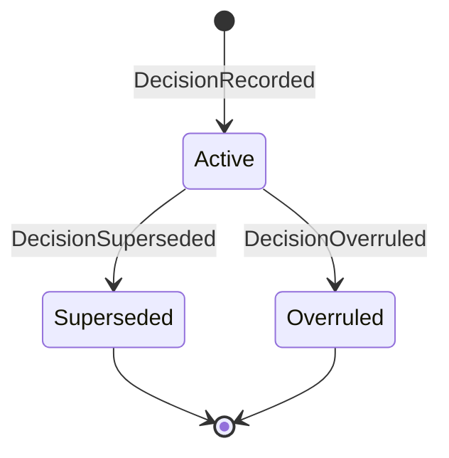
<!-- /chart:decision -->

| From | To | Trigger | Guard | Event |
|---|---|---|---|---|
| — | Active | Caused by `RulingGiven` on an escalation | The escalation is ruled | `DecisionRecorded`: the option chosen, and every other option as a rejected alternative |
| Active | Superseded | A later decision with the same or wider scope | `scopeCovers(new, old)` in the proposition scope grammar; an absent scope is everywhere | `DecisionSuperseded` |
| Active | Overruled | `OverruleRequested`, escalated, and ruled in favour | The escalation is ruled `overrule`, and its category is `overrule-request` | `DecisionOverruled` |

**Stances** do not change a Decision's state; each is a fact about a change: `PrecedentSurfaced` (preflight showed it), then `PrecedentFollowed`, `PrecedentDistinguished` or `OverruleRequested`.

**Terminal:** Superseded, Overruled.

**Invariant:** a precedent never blocks by itself; only guards do. A Decision carries its date, scope, evidence and the alternatives it rejected.

---

## Tenet

Owner: Subject DO. A Tenet is a belief trunk currently holds: an effect that has landed and is backed by at least one guard.

<!-- chart:tenet — generated from packages/core/test/charts/charts.ts by render.ts; edit the chart, not this block -->
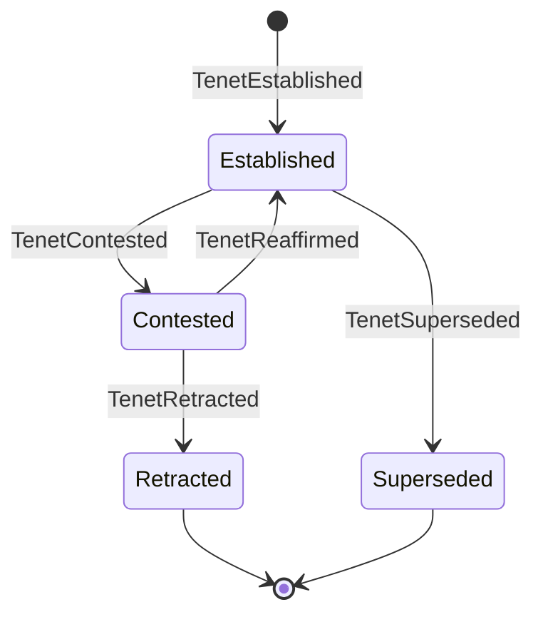
<!-- /chart:tenet -->

| From | To | Trigger | Guard | Event |
|---|---|---|---|---|
| — | Established | Caused by `ChangeLanded` | The landed effect is backed by at least one admitted guard (otherwise refused, `unguarded`) | `TenetEstablished` |
| Established | Contested | A change's effect contradicts the tenet | The conflict is open (suspected, probing, proven or escalated) and names the tenet as a party | `ConflictSuspected` (tenet as party), then `TenetContested` |
| Contested | Established | The contesting conflict is dismissed, or resolved by `distinguish` or `yield` | Any other state or move is refused (`conflict-unsettled`) | `TenetReaffirmed` |
| Contested | Retracted | A change lands against the tenet, on a ruling | A `decisionId`, under any policy | `TenetRetracted` (with `decisionId`) |
| Contested | Retracted | A change lands against the tenet, on proof, where the predicate's policy is `advise` or `annotate` (absent is `advise`) | The contesting conflict is `proven` and the landing change is a party; under `block` a ruling is required (`ruling-required`); opinion never retracts (`not-proven`) | `TenetRetracted` (citing the conflict) |
| Established | Superseded | A new tenet on the same `(subject, predicate)` replaces it | — | `TenetSuperseded` |

**Terminal:** Retracted, Superseded.

**Policy** (ADR 0005, decided 11 Oct): a project composes its predicate policy per change, like flows, and chooses per predicate whether a proven conflict `block`s, `advise`s or `annotate`s; the default is `advise`. Only retraction reads it: under `block` the challenger waits for a ruling, so a tenet leaves Contested only by a ruling or by being reaffirmed; under `advise` or `annotate` the challenger may land, so trunk no longer holds the belief and the proof retracts it, citing the conflict. A tenet never blocks by itself.

**Invariant:** new code that calls a symbol carrying a tenet is subscribed to that tenet automatically (an implied premise).

---

## Agent

Owner: AgentSession DO. An agent is made one of two ways: it signs itself up with a key (`AgentSignedUp`: its id and handle are made from the key, and it has no project and no kind), or a person enrols it in a project (`AgentEnrolled`: kinds interactive, hosted, human, synthetic). Signing up again with the same key commits nothing; another key never joins an agent that way.

<!-- chart:agent — generated from packages/core/test/charts/charts.ts by render.ts; edit the chart, not this block -->
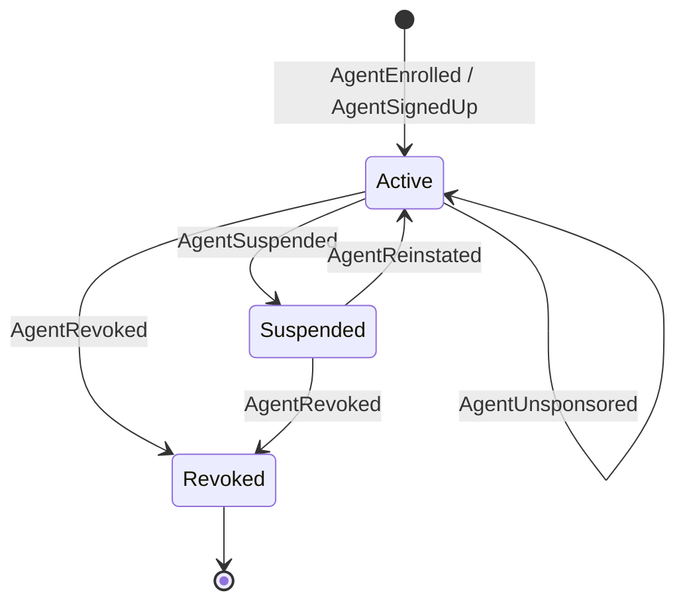
<!-- /chart:agent -->

**Terminal:** Revoked. Revocation bumps the agent's revocation epoch by exactly one (an agent enrols at epoch 0), so every token minted before it fails verification. A suspended agent's tokens fail too, until it is reinstated.

**The sponsor link.** A person stands behind an agent: `Sponsor` commits `AgentSponsored`, and `EndSponsorship` commits `AgentUnsponsored`. An agent has at most one sponsor: the same person sponsoring again commits nothing, and another is refused until the first has switched the link off. The link carries no rights. Only its two parties end it, the sponsor or the agent itself; anyone else is refused as no party to it, and the event names which of the two it was. A revoked agent takes neither command and keeps the record of who stood behind it.

**A pause holds.** A suspended agent becomes active again by a reinstatement, or by its sponsor ending the link: that commits `AgentReinstated` first, since nobody else could reinstate it. Nothing else lifts a pause. The agent cannot leave its sponsor while it is paused, and nobody becomes the sponsor of a paused agent, so a person who was not behind the agent when it was paused never lifts the pause by leaving. Both are refused with the reason that the agent is paused.

**Invariant:** declaration fidelity routes review; it never judges the agent.

---

## Sketch

Owner: WorkspacePool DO.

<!-- chart:sketch — generated from packages/core/test/charts/charts.ts by render.ts; edit the chart, not this block -->
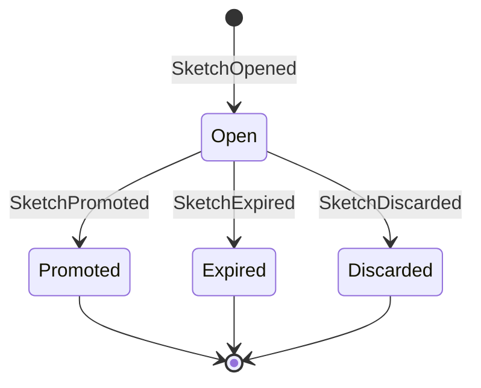
<!-- /chart:sketch -->

**Terminal:** Promoted, Expired, Discarded. A sketch has no intent, no preflight and no integration; `SketchExpired` is raised by its TTL deadline alarm. Promotion hands its workspace to the new change (`WorkspaceReassigned`).

Whether a sketch has expired is computed on read, from `expiresAt` and the time passed in: from its deadline on it can no longer be promoted or discarded (refused as expired, with declaring a change as the next action), whether or not the alarm has fired. An alarm that fires early commits nothing; the pool re-arms it only while the sketch is Open.

---

## Workspace

Owner: WorkspacePool DO. A Workspace is the throwaway Artifacts repo a Change or Sketch is worked in.

<!-- chart:workspace — generated from packages/core/test/charts/charts.ts by render.ts; edit the chart, not this block -->
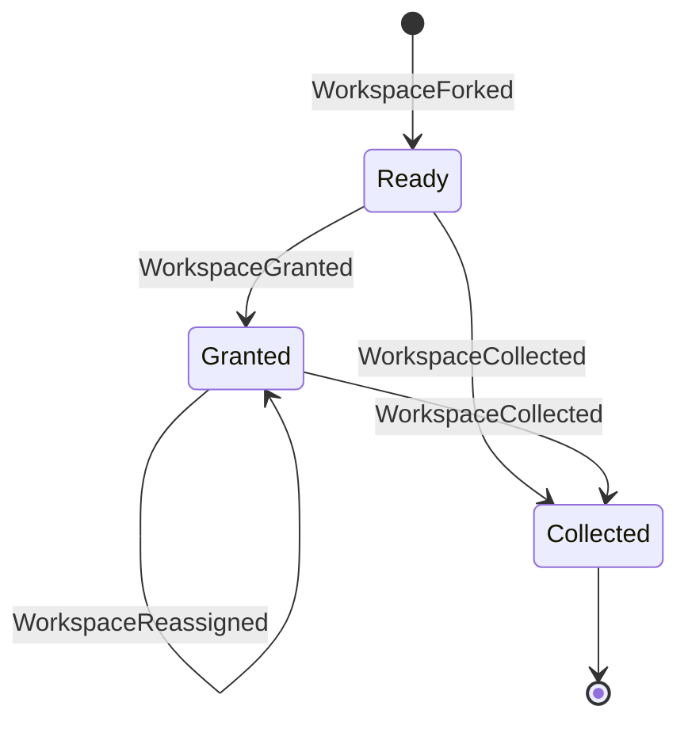
<!-- /chart:workspace -->

**Terminal:** Collected.

**Invariants**
- A ready workspace is granted exactly once; promotion reassigns it from the sketch to the new change, never to a third holder. A repeated grant to the same holder is a no-op (the pool mints that retry a fresh token), one to another holder is refused, and collecting a collected workspace again is a no-op.
- The pool's own slots also pass through `forking` (before `WorkspaceForked`, so not yet a workspace) and `collecting` (the repo's deletion in progress, still Collected here).
- A fork is ready when the pool's own fork call resolves (spike S2); nothing polls for it.

---

## Deployment (deferred to L5)

Owner: the DO that created it. The machine is fixed when the `Deployer` adapters land:

- preview: Previewing → Live → TornDown (`PreviewDeployed`, `PreviewTornDown`);
- promotion: Promoting, through the target's stages (e.g. 10% → 100%) → Promoted | RolledBack (`DeploymentPromoted`, `DeploymentRolledBack`).

### Deploy targets

Owner: the Project DO. A project holds up to 16 deploy targets, one a name, and each is a record: the name a repo's `.keel/deploy` gives, the provider, the account there and the id of a credential in the org's store. It has no states, only what is set: two decisions and a fold, in `domain/delivery/deploy-target.ts`.

- **Set** commits `DeployTargetSet` with the whole record, new or in place of the one of that name. It is refused when the credential is not in the project's own org (the caller reads that from the org's credential store and passes it as a fact), so no project deploys with another org's secret, and when the name would be a seventeenth. Setting a target to exactly what it is commits nothing.
- **Clear** commits `DeployTargetCleared`; a name that is not set is refused.
- The fold keeps one record a name, in name order. Resolving a name gives the whole record as it stands, which is what the Deployer's plan step takes: a plan keeps the account and the credential reference it was made with, whatever is set afterwards.
- The record names a credential and never holds one: the credential's id is minted when a secret is stored, so nothing a person types fits the field. Only an owner of the project's org sets or clears a target, and only an owner of an org touches its credentials.
