# State machines

Each entity below is owned by one Durable Object, which is its source of truth. Every transition commits the new state and its event (see [events.md](events.md)) in one `transactionSync`. A transition is triggered by a **command** (an API call, or a Workflow step calling the owning DO) or by **another entity's event**, in which case the new event's `causation` names it. When one command drives two transitions (a change bounced while its lease has lapsed), both events commit in the same transaction.

Each machine reaches **exactly one terminal state** per run, and replaying an entity's events in `seq` order rebuilds its state exactly. Both properties are property-tested in the domain tier.

Terms are in [CONTEXT.md](../../CONTEXT.md).

## Ownership

| Entity | Owning DO | DO key |
|---|---|---|
| agent | AgentSession DO | `agent:<agentId>` |
| session | AgentSession DO | `agent:<agentId>` |
| change (and its lease) | Change DO | `change:<ULID>` |
| subject | Subject DO; the subject registry (keys, aliases, anchors) is in the Project DO | `subj:<project>:<key>` |
| project | Project DO | `project:<projectId>` |
| sketch | WorkspacePool DO | `pool:<project>` |
| workspace | WorkspacePool DO | `pool:<project>` |
| conflict | Subject DO for `semantic` and `precedent`; Lane DO for `textual` and `interaction` | `subj:…` / `lane:<project>:<id>` |
| probe | the DO that owns its conflict | as its conflict |
| guard | the DO that owns the conflict it proved | as its conflict |
| batch | Lane DO | `lane:<project>:<id>` |
| candidate | Lane DO | `lane:<project>:<id>` |
| verdict | the DO that issued it: Change DO for a change, Lane DO for a batch | as its issuer |
| decision | Subject DO | `subj:<project>:<key>` |
| tenet | Subject DO | `subj:<project>:<key>` |
| escalation | the DO that raised it | as its raiser |
| deployment | the DO that created it | as its creator |

D1 holds projections only (the catalog, and `AgentDirectory`'s client-credential index). No decision reads K2 or D1.

---

## Change

Owner: Change DO.

**Agent-owned states** are Declared, Working, Drifted and Bounced: the change waits on its agent. In every other non-terminal state the platform owns it.

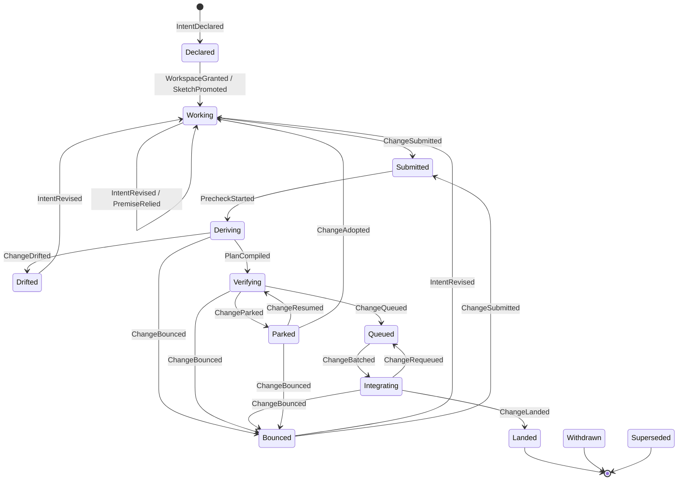

| From | To | Trigger | Guard | Event |
|---|---|---|---|---|
| — | Declared | `declare` (or `declare --from-sketch`), or the Auditor declaring a revert | Scope `agent:work` for agents | `IntentDeclared {origin}` (lease issued), then `PreflightIssued` |
| Declared | Working | The pool grants a workspace, or the promoted sketch's workspace is reassigned | — | caused by `WorkspaceGranted` or `SketchPromoted` |
| Working | Working | `revise` / `rely` | Valid lease; `If-Match` on the current revision | `IntentRevised` / `PremiseRelied` |
| Working, Bounced | Submitted | `submit {changeId, commitSha}` | Valid lease; the commit is in the change's workspace | `ChangeSubmitted` |
| Submitted | Deriving | Precheck instance created | — | `PrecheckStarted` |
| Deriving | Bounced | Precheck: a protected or guard path is touched | — | `ChangeBounced` |
| Deriving | Drifted | Precheck: drift needs the agent (an undeclared proof-class effect) | — | `ChangeDrifted` |
| Deriving | Verifying | Precheck: effects derived, drift classified, plan compiled | — | `EffectsDerived`, `DriftDetected`, then `PlanCompiled` |
| Drifted, Bounced | Working | `revise` | Valid lease | `IntentRevised` |
| Verifying | Queued | The plan's pre-queue steps pass and no Proven conflict is open | — | `ChangeQueued` |
| Verifying | Bounced | A conflict is proven against the change, or a guard fails | — | `ChangeBounced` |
| Verifying | Parked | A human-class conflict or step | — | `ChangeParked {reason: awaiting-ruling}` |
| Queued | Integrating | Caused by `BatchFormed` | — | `ChangeBatched` |
| Integrating | Queued | Caused by `BatchFailed {infra}`, `CandidateBisected` or `CandidateInvalidated` | Two infra failures requeue with no blame | `ChangeRequeued` |
| Integrating | Bounced | Caused by `BatchFailed` attributed to this change | — | `ChangeBounced` |
| Integrating | Landed | Caused by `TrunkAdvanced` | No open Proven conflict, no failing guard, no unresolved high-severity drift | `ChangeLanded` |
| Parked (awaiting-ruling) | Verifying | Caused by `RulingGiven` | — | `ChangeResumed` |
| Parked (awaiting-ruling) | Bounced | Caused by `RulingGiven` choosing to bounce | — | `ChangeBounced` |
| Parked (lease-lapsed) | Working | `adopt` | The lease is Lapsed | `ChangeAdopted` (new lease; the old token is fenced) |
| Parked (awaiting-ruling) | Parked (awaiting-ruling) | `adopt` | The lease is Lapsed | `ChangeAdopted`: the change keeps waiting, now with the new lease |
| an agent-owned state | Parked (lease-lapsed) | The lease's deadline alarm | The lease lapsed: 15 minutes since `renewedAt` | `LeaseLapsed`, then `ChangeParked {reason: lease-lapsed}` |
| a platform-owned state | an agent-owned state, with a Lapsed lease | Any transition into Bounced, Drifted, or Working after a ruling | The lease lapsed while the platform owned the change | that transition's event, then `ChangeParked {reason: lease-lapsed}` in the same transaction |
| any but Integrating and terminal | Withdrawn | `abandon` | Valid lease, or scope `operator` | `ChangeWithdrawn` |
| any but Integrating and terminal | Superseded | A ruling chooses an alternative; or, by policy, an alternative that retracts a tenet loses automatically when the winner lands | — | `ChangeSuperseded` (caused by `RulingGiven` or by the winner's `ChangeLanded`) |

**Terminal:** Landed, Withdrawn, Superseded.

**Invariants and properties**
- Trunk advances only through the Trunk DO; no agent ever holds a trunk token.
- A change cannot land with an open Proven conflict, a failing guard, or unresolved high-severity drift.
- Effects used in any verdict are derived by Keel, never taken from the agent.
- A lapse parks only agent-owned states. In Integrating the change belongs to its batch, so withdrawal waits until the batch resolves.
- **No orphaned change:** for every event sequence, a change in an agent-owned state has an Active lease or is Parked. (Property-tested: a lease lapsing in any platform-owned state, followed by any transition into an agent-owned state, ends Parked.)
- Every landed change has an Intent revision, a Session link and a Verdict with evidence.

---

## Lease

Owner: Change DO. A Lease is a permit to act on a Change, carrying a server-minted fencing token (`lse_…`). It is never exclusive over files.

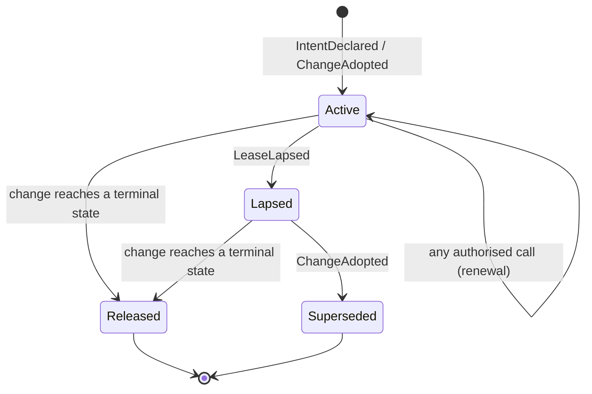

| From | To | Trigger | Guard | Event |
|---|---|---|---|---|
| — | Active | `declare` or `adopt` | — | `IntentDeclared` / `ChangeAdopted` carry the `leaseId` |
| Active | Active | Any MCP or REST call on the change, or the agent's hook | The call carries this `leaseId` | none: `renewedAt` is state, not an event |
| Active | Lapsed | The deadline alarm at `renewedAt + 15 min` | No renewal since | `LeaseLapsed` |
| Lapsed | Superseded | `adopt` by any agent with scope `agent:work` | — | `ChangeAdopted` (the new lease's token fences the old) |
| Active, Lapsed | Released | The change lands, is withdrawn or is superseded (e.g. an operator withdraws a parked change) | — | the change's terminal event |

**Terminal:** Released, Superseded.

**Invariants**
- Every mutating call on a change carries its `leaseId`; a call with a stale token is refused with next actions. "No lease" is never permission.
- Whether a lease has lapsed is computed on read; the alarm only makes the lapse visible as an event. It is a deadline, never a polling loop.
- Adoption is a lease operation: it is allowed whenever the lease is Lapsed, whatever the change is waiting on.

---

## Conflict

Owner: by kind. The Subject DO owns `semantic` and `precedent` conflicts. `textual` (a refused merge) and `interaction` (every subset of a batch passes, the union fails) conflicts have no subject, so the Lane DO owns them.

Footprint overlap is not a conflict: it is *exposure*, reported in preflight's neighbours. Proximity never opens a conflict.

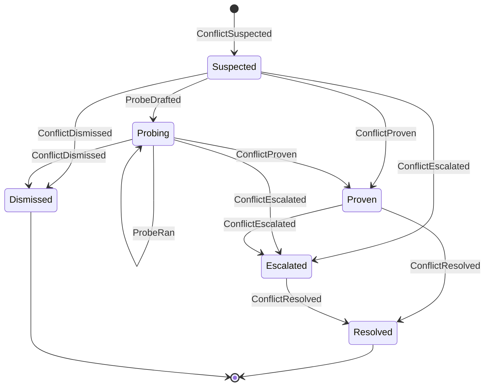

| From | To | Trigger | Guard | Event |
|---|---|---|---|---|
| — | Suspected | Fallout: a same-key contradiction with intersecting scope, or a silent retraction (semantic); a precedent's guard at risk (precedent); a refused merge (textual); a batch whose union fails while every subset passes (interaction) | Proximity alone never opens a conflict | `ConflictSuspected` |
| Suspected | Proven | Proof without a probe: a merge GitCore and MergeBox both refuse (textual), or a failing guard (precedent) | — | `ConflictProven` |
| Suspected | Dismissed | A deterministic lattice comparison shows the propositions are compatible (a ruling) | — | `ConflictDismissed` |
| Suspected | Probing | A probe compiles and runs | — | `ProbeDrafted` |
| Suspected | Escalated | Three drafts fail: the conflict is unprovable | — | `ProbeDiscarded {draft-failed}`, then `ConflictEscalated {reason: unprovable}` |
| Probing | Probing | One world-matrix cell completes | — | `ProbeRan` |
| Probing | Proven | The probe discriminates | It passes on trunk (or does not apply), passes in the premise-holder's world, fails in the combined world, three runs in a row | `GuardAdmitted`, then `ConflictProven` |
| Probing | Dismissed | The probe gives the same answer in every world | — | `ProbeDiscarded {non-discriminating}`, then `ConflictDismissed` |
| Probing | Escalated | The probe is unstable across runs | — | `ProbeDiscarded {unstable}`, then `ConflictEscalated {reason: unprovable}` |
| Proven | Escalated | The conflict is human-class | Permission semantics, destructive migrations, ambiguous requirements | `ConflictEscalated {reason: human-class}` |
| Proven | Resolved | A Move is applied (bounce, sequence, yield, merge, distinguish…) | — | `ConflictResolved` |
| Escalated | Resolved | Caused by `RulingGiven` | — | `ConflictResolved` (with `decisionId`) |

**Terminal:** Resolved, Dismissed.

**Invariants**
- Only proof or a ruling moves a conflict to Proven or Dismissed. An unprovable conflict is opinion, and it escalates rather than blocking.
- A dismissal is recorded as evidence, so the same alarm is not raised again on the same facts.

---

## Probe → Guard

Owner: the DO that owns the probe's conflict. If a probe proves the disagreement it is admitted as a Guard in the guard repo, which agents cannot write to.

**A probe entity begins with its first event:** `ProbeDrafted` (a draft compiled and ran) or `ProbeDiscarded {draft-failed}` (three drafts failed). Drafting and its bounded repair loop (≤ 3 attempts, driven by deterministic error text) are a phase inside one Workflow step, not a persisted state, so replay rebuilds a probe exactly from its events.

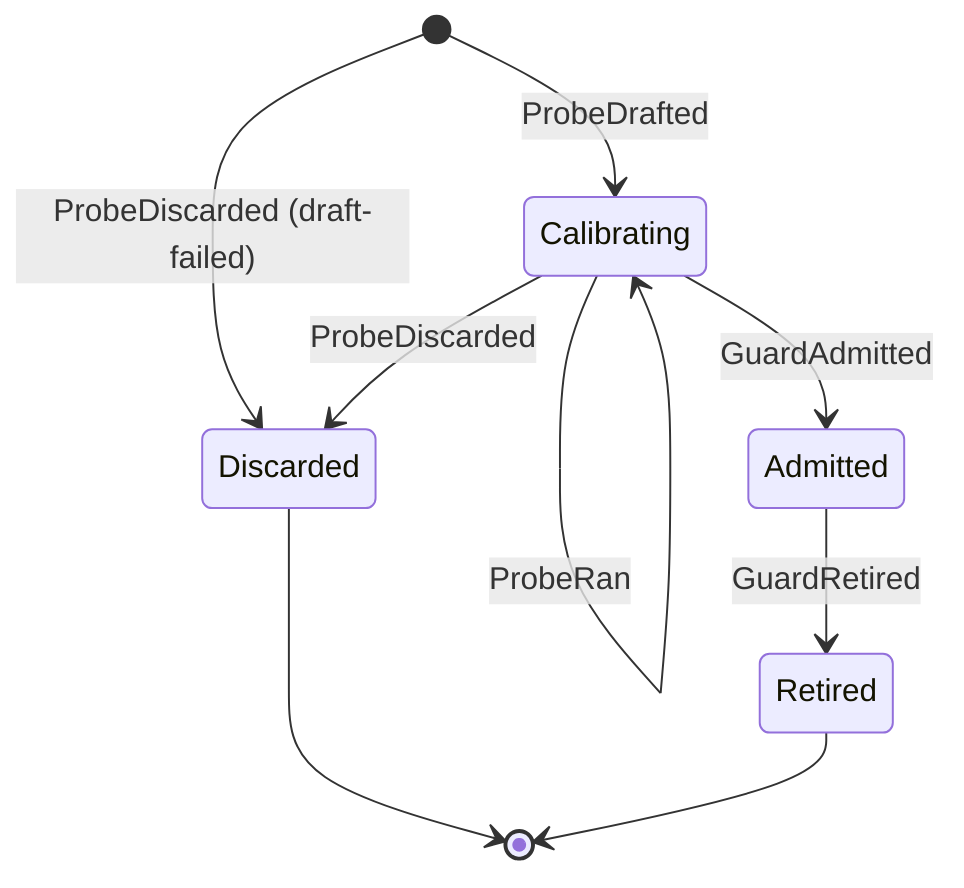

| From | To | Trigger | Guard | Event |
|---|---|---|---|---|
| — | Calibrating | A draft compiles and runs | Attempts ≤ 3 | `ProbeDrafted` |
| — | Discarded | Three drafts failed | — | `ProbeDiscarded {reason: draft-failed}` |
| Calibrating | Calibrating | One world-matrix cell (trunk, A, B or AB; run 1–3) completes | — | `ProbeRan` |
| Calibrating | Admitted | Computed from the `ProbeRan` cells | Passes on trunk (or does not apply), passes in the premise-holder's world, fails in the combined world, stable over 3 runs | `GuardAdmitted` |
| Calibrating | Discarded | Not discriminating, or unstable | — | `ProbeDiscarded` |
| Admitted | Retired | A superseding Decision | — | `GuardRetired` |

**Terminal:** Discarded, Retired. (An admitted Guard stays Admitted, guarding trunk, until a Decision retires it.)

**Invariants**
- A drafted probe is opinion until it discriminates.
- Only guards block on behalf of past decisions; a change whose diff touches guard paths is refused at Precheck.
- A guard that turns unstable on trunk is escalated to a person, never quarantined automatically: protected checks are human-class.

---

## Candidate

Owner: Lane DO. A **Batch** is a set of Changes verified together; its **Candidate** is the tree composed for one attempt. They are one-to-one per attempt, so the batch events are the candidate's transitions. Promotion onto trunk belongs to the Trunk DO (below).

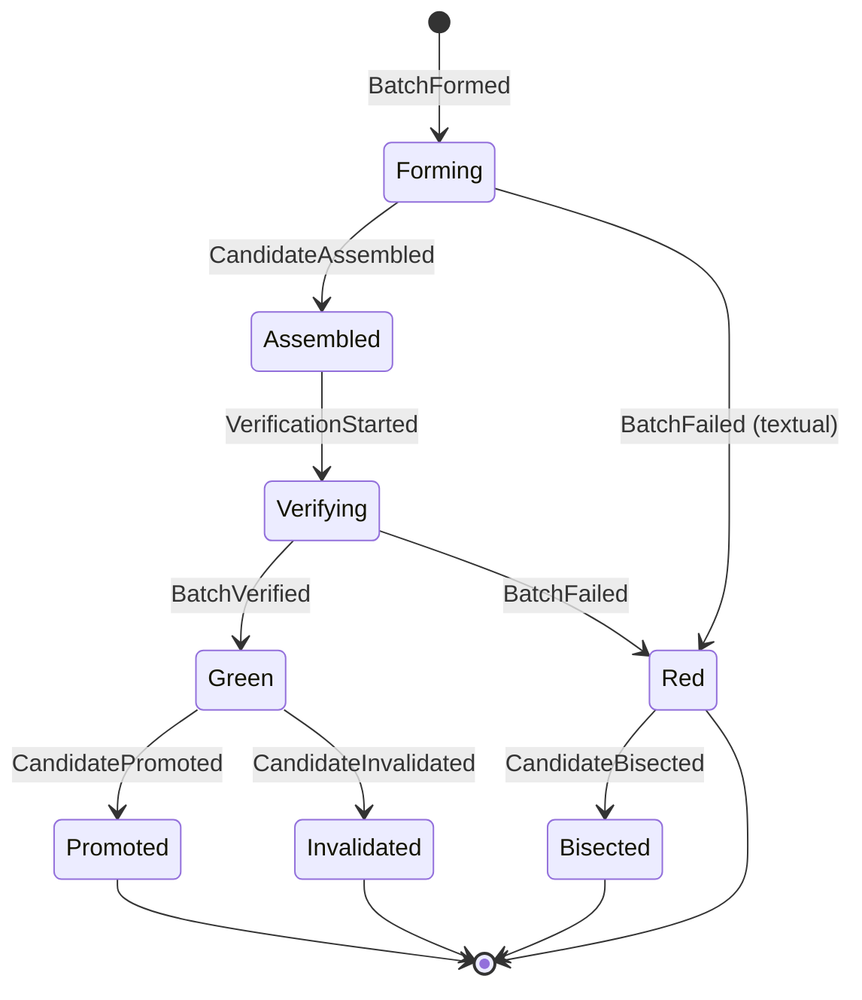

| From | To | Trigger | Guard | Event |
|---|---|---|---|---|
| — | Forming | The lane forms a batch | N = clamp(ln 0.8 / ln(1−p), 1, 16); no two members with an open suspected conflict or opposite effects on one subject; risky changes alone; speculation ≤ 4 deep | `BatchFormed` |
| Forming | Assembled | GitCore composes the tree (Tier 0), or MergeBox when GitCore refuses (Tier 2) | — | `CandidateAssembled` (with tier and reason) |
| Forming | Red | GitCore and MergeBox both refuse to compose | — | `BatchFailed {attribution: textual}`, then a textual `ConflictSuspected` → `ConflictProven`, owned by the Lane DO |
| Assembled | Verifying | KeelVerify instance created | — | `VerificationStarted` |
| Verifying | Green | The union of the members' plans passes | Results fenced on `(batchId, attempt, chainEpoch)` | `BatchVerified` |
| Verifying | Red | A step fails after a flake rerun | — | `BatchFailed` (attribution: a change, `interaction` or `infra`) |
| Red | Bisected | More than one member, and the failure is not yet attributed | — | `CandidateBisected` (new batches) |
| Green | Promoted | Caused by `TrunkAdvanced` | — | `CandidatePromoted` |
| Green | Invalidated | Caused by `PromotionDeclined`: trunk moved and the commutation rule fails | — | `CandidateInvalidated` |

**Terminal:** Promoted, Invalidated, Bisected, Red (a refused composition, or a single attributed member, which bounces).

**Invariants**
- An interaction failure (every subset passes, the union fails) opens an `interaction` conflict owned by the Lane DO.
- Every step records its tier and the reason it was chosen. An escalation to a higher tier is sticky and visible.

### Promotion (Trunk DO)

Owner: Trunk DO (`trunk:<project>`), the one writer of trunk ([ADR 0003](../adr/0003-trunk-single-writer-wal.md)).

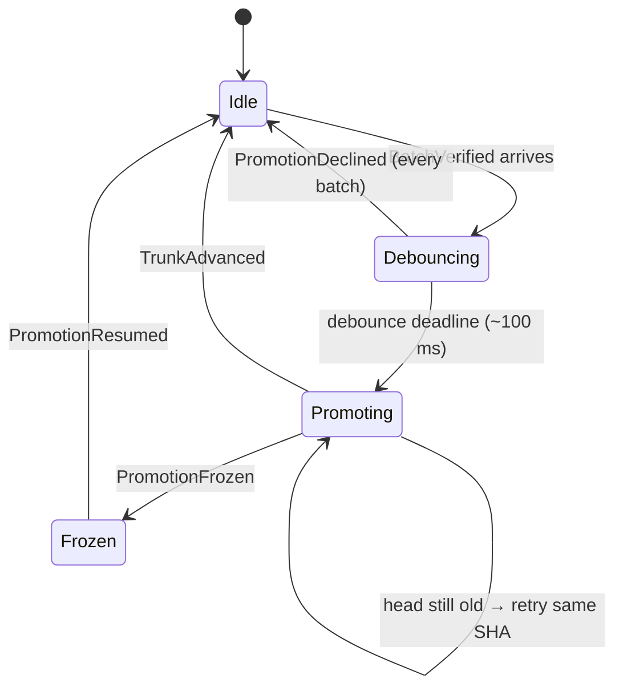

| From | To | Trigger | Guard | Event |
|---|---|---|---|---|
| Idle | Debouncing | A `BatchVerified` arrives | — | none: the debounce alarm is armed (a named debounce) |
| Debouncing | Promoting | The debounce deadline fires | The commutation rule (C1–C6) holds for at least one batch | `PromotionDeclined` for each batch it fails for; the WAL entry `PendingGroup {old, members, committerTime}` is written for the rest |
| Debouncing | Idle | The commutation rule fails for every batch | — | `PromotionDeclined` for each |
| Promoting | Promoting | Read-back shows the head is still `old` | — | none: the push is retried with the same SHA |
| Promoting | Idle | Read-back shows the head is `new` | — | `TrunkAdvanced` |
| Promoting | Frozen | Read-back shows any other head | — | `PromotionFrozen` |
| Frozen | Idle | An operator releases the freeze | Scope `operator` | `PromotionResumed` |

The Auditor's full-suite run on each new head is recorded as `AuditCompleted`. On red it bisects across commutation-promoted commits and declares a revert change with `origin: auditor`, which lands like any other change.

**Invariants**
- The compose is deterministic, so a retry produces the same SHA.
- Artifacts' own compare-and-swap, if it exists, is a second fence and never the only one.

---

## Escalation

Owner: the DO that raised it. An Escalation is a question routed to a person, with options and their consequences.

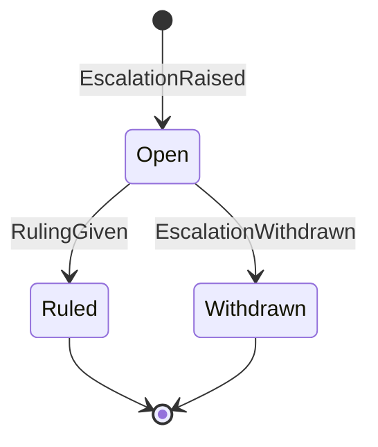

| From | To | Trigger | Guard | Event |
|---|---|---|---|---|
| — | Open | A human-class conflict or step, an unprovable conflict, an overrule request, a frozen trunk | — | `EscalationRaised` |
| Open | Ruled | A person answers | Scope `operator` | `RulingGiven`, emitted by the owner; it resumes waiting Workflows through `sendEvent` |
| Open | Withdrawn | Its subject was resolved some other way | — | `EscalationWithdrawn` |

**Terminal:** Ruled, Withdrawn. The default while Open is *hold*. A ruling produces a Decision.

---

## Decision

Owner: Subject DO. A Decision is a recorded ruling. Later changes meet it as a Precedent and record a Stance.

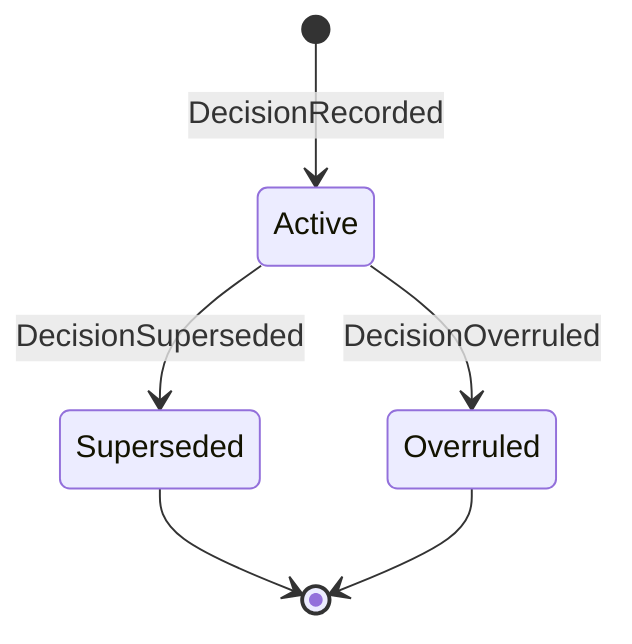

| From | To | Trigger | Guard | Event |
|---|---|---|---|---|
| — | Active | Caused by `RulingGiven` on an escalation | — | `DecisionRecorded` |
| Active | Superseded | A later decision with the same or wider scope | — | `DecisionSuperseded` |
| Active | Overruled | `OverruleRequested`, escalated, and ruled in favour | — | `DecisionOverruled` |

**Stances** do not change a Decision's state; each is a fact about a change: `PrecedentSurfaced` (preflight showed it), then `PrecedentFollowed`, `PrecedentDistinguished` or `OverruleRequested`.

**Terminal:** Superseded, Overruled.

**Invariant:** a precedent never blocks by itself; only guards do. A Decision carries its date, scope, evidence and the alternatives it rejected.

---

## Tenet

Owner: Subject DO. A Tenet is a belief trunk currently holds: an effect that has landed and is backed by at least one guard.

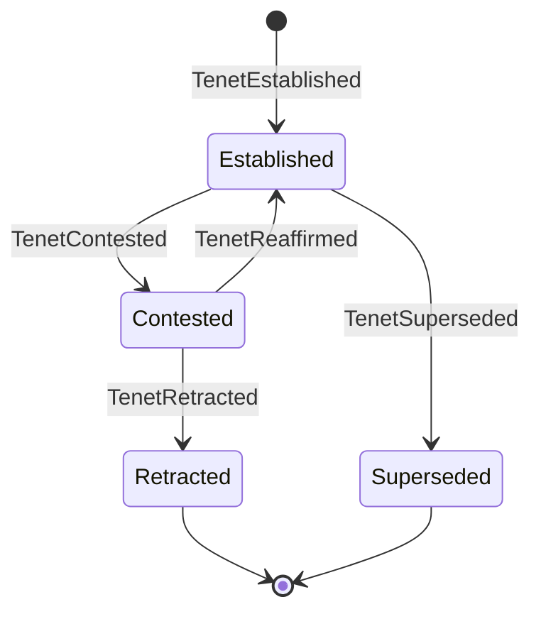

| From | To | Trigger | Guard | Event |
|---|---|---|---|---|
| — | Established | Caused by `ChangeLanded` | The landed effect is backed by at least one admitted guard | `TenetEstablished` |
| Established | Contested | A change's effect contradicts the tenet | — | `ConflictSuspected` (tenet as party), then `TenetContested` |
| Contested | Established | The conflict is dismissed or resolved in the tenet's favour | — | `TenetReaffirmed` |
| Contested | Retracted | A ruled change lands that removes the belief | A ruling, never opinion | `TenetRetracted` |
| Established | Superseded | A new tenet on the same `(subject, predicate)` replaces it | — | `TenetSuperseded` |

**Terminal:** Retracted, Superseded.

**Invariant:** new code that calls a symbol carrying a tenet is subscribed to that tenet automatically (an implied premise).

---

## Agent

Owner: AgentSession DO. Kinds: interactive, hosted, human.

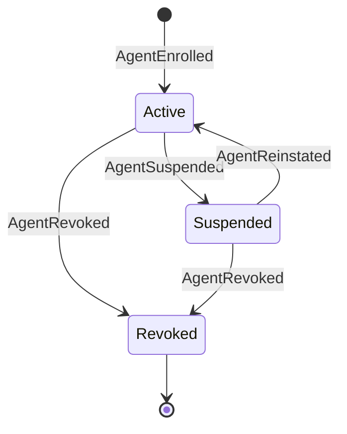

**Terminal:** Revoked. Revocation bumps the agent's revocation epoch, so every token minted before it fails verification.

**Invariant:** declaration fidelity routes review; it never judges the agent.

---

## Sketch

Owner: WorkspacePool DO.

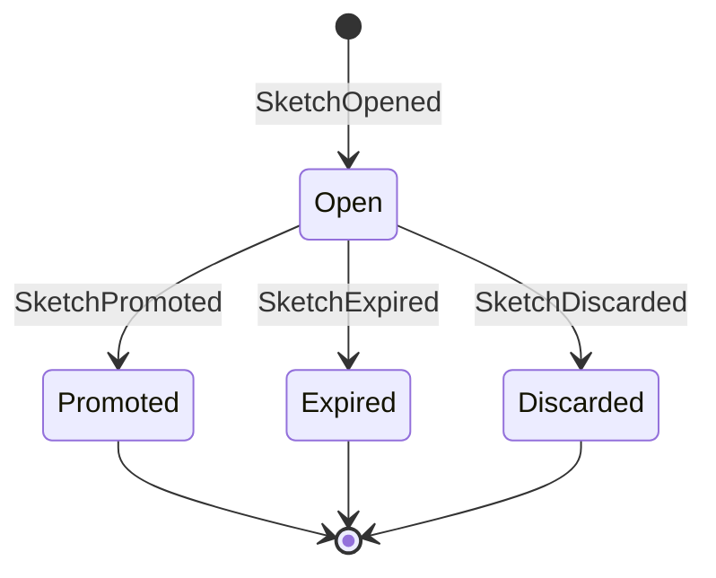

**Terminal:** Promoted, Expired, Discarded. A sketch has no intent, no preflight and no integration; `SketchExpired` is raised by its TTL deadline alarm. Promotion hands its workspace to the new change.

---

## Workspace

Owner: WorkspacePool DO. A Workspace is the throwaway Artifacts repo a Change or Sketch is worked in.

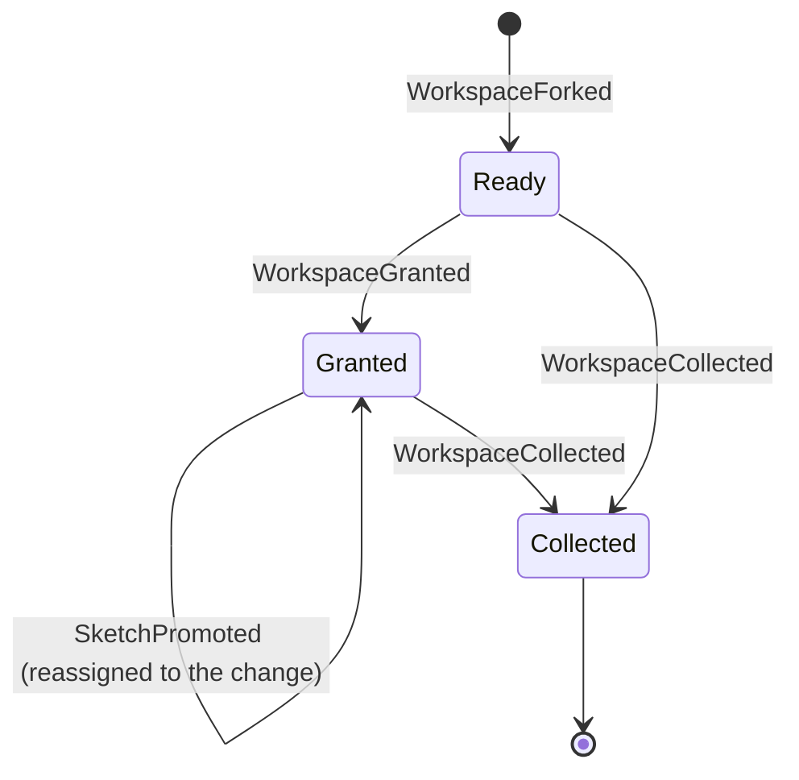

**Terminal:** Collected.

**Invariants**
- A ready workspace is granted exactly once; promotion reassigns it from the sketch to the new change, never to a third holder.
- Fork readiness comes from the `repo.forked` event, never from polling.

---

## Deployment (deferred to L5)

Owner: the DO that created it. The machine is fixed when the `Deployer` adapters land:

- preview: Previewing → Live → TornDown (`PreviewDeployed`, `PreviewTornDown`);
- promotion: Promoting, through the target's stages (e.g. 10% → 100%) → Promoted | RolledBack (`DeploymentPromoted`, `DeploymentRolledBack`).
