# State machines

Each entity below is owned by one Durable Object, which is its source of truth. Every transition commits the new state and its event (see [events.md](events.md)) in one `transactionSync`. A transition is triggered by a **command** (an API call, or a Workflow step calling the owning DO) or by **another entity's event**, in which case the new event's `causation` names it. When one command drives two transitions (a change bounced while its lease has lapsed), both events commit in the same transaction.

Each machine reaches **exactly one terminal state** per run, and replaying an entity's events in `seq` order rebuilds its state exactly. Both properties are property-tested in the domain tier.

Terms are in [CONTEXT.md](../../CONTEXT.md).

## Ownership

| Entity | Owning DO | DO key |
|---|---|---|
| agent | AgentSession DO | `agent:<agentId>` |
| session | AgentSession DO | `agent:<agentId>` |
| change (and its lease) | Change DO | `change:<ULID>` |
| subject | Subject DO; the subject registry (keys, aliases, anchors) is in the Project DO | `subj:<project>:<key>` |
| project | Project DO | `project:<projectId>` |
| workspace | WorkspacePool DO | `pool:<project>` |
| conflict | Subject DO for `semantic` and `precedent`; Lane DO for `textual` and `interaction` | `subj:…` / `lane:<project>:<id>` |
| probe | the DO that owns its conflict | as its conflict |
| guard | the DO that owns the conflict it proved | as its conflict |
| batch | Lane DO | `lane:<project>:<id>` |
| trunk (promotion) | Trunk DO | `trunk:<projectId>`: its own entity kind and seq, apart from the project's |
| candidate | Lane DO | `lane:<project>:<id>` |
| verdict | the DO that issued it: Change DO for a change, Lane DO for a batch | as its issuer |
| decision | the namespace object that took the ruling, in the ruling's own transaction | `ns:<namespaceId>` |
| tenet | Subject DO | `subj:<project>:<key>` |
| escalation | the object of the namespace that owns its project | `ns:<namespaceId>` |
| deployment | the DO that created it | as its creator |
| user | none: D1 (Better Auth) holds it; its tenancy events are committed for the audit | `user:<userId>` |
| org | none: D1 (Better Auth) holds it; its tenancy events are committed to the org's object | `org:<orgId>` |

D1 holds projections only (the catalog, and `AgentDirectory`'s client-credential index). No decision reads K2 or D1.

---

## Change

Owner: Change DO.

**Agent-owned states** are Declared, Working, Drifted and Bounced: the change waits on its agent. In every other non-terminal state the platform owns it.

<!-- chart:change — generated from packages/core/test/charts/charts.ts by render.ts; edit the chart, not this block -->
```mermaid
stateDiagram-v2
  [*] --> Declared: IntentDeclared
  state Parked {
    AwaitingRuling
    AwaitingApproval
    LeaseLapsed
  }
  Declared --> Working: ChangeStarted
  Declared --> LeaseLapsed: ChangeParked
  Declared --> Declared: ChangeAdopted
  Declared --> Withdrawn: ChangeWithdrawn
  Declared --> Superseded: ChangeSuperseded
  Working --> Working: IntentRevised
  Working --> Submitted: ChangeSubmitted
  Working --> Working: ChangeRebased
  Working --> LeaseLapsed: ChangeParked
  Working --> Working: ChangeAdopted
  Working --> Withdrawn: ChangeWithdrawn
  Working --> Superseded: ChangeSuperseded
  Submitted --> Deriving: PrecheckStarted
  Submitted --> Working: ProposalUpdated
  Submitted --> Withdrawn: ChangeWithdrawn
  Submitted --> Superseded: ChangeSuperseded
  Deriving --> Drifted: ChangeDrifted
  Deriving --> Verifying: PlanCompiled
  Deriving --> Bounced: ChangeBounced
  Deriving --> Working: ProposalUpdated
  Deriving --> Withdrawn: ChangeWithdrawn
  Deriving --> Superseded: ChangeSuperseded
  Drifted --> Working: IntentRevised
  Drifted --> LeaseLapsed: ChangeParked
  Drifted --> Drifted: ChangeAdopted
  Drifted --> Working: ProposalUpdated
  Drifted --> Withdrawn: ChangeWithdrawn
  Drifted --> Superseded: ChangeSuperseded
  Verifying --> Queued: ChangeQueued
  Verifying --> AwaitingRuling: ChangeParked [for a ruling]
  Verifying --> AwaitingApproval: ChangeParked [a proposal, for its approval]
  Verifying --> Bounced: ChangeBounced
  Verifying --> Working: ProposalUpdated
  Verifying --> Withdrawn: ChangeWithdrawn
  Verifying --> Superseded: ChangeSuperseded
  Queued --> Integrating: ChangeBatched
  Queued --> AwaitingRuling: ChangeParked [for a ruling]
  Queued --> AwaitingApproval: ChangeParked [a proposal, for its approval]
  Queued --> Bounced: ChangeBounced
  Queued --> Working: ProposalUpdated
  Queued --> Withdrawn: ChangeWithdrawn
  Queued --> Superseded: ChangeSuperseded
  Integrating --> Queued: ChangeRequeued
  Integrating --> Bounced: ChangeBounced
  Integrating --> Landed: ChangeLanded
  Bounced --> Working: IntentRevised
  Bounced --> Submitted: ChangeSubmitted
  Bounced --> Bounced: ChangeRebased
  Bounced --> LeaseLapsed: ChangeParked
  Bounced --> Bounced: ChangeAdopted
  Bounced --> Working: ProposalUpdated
  Bounced --> Withdrawn: ChangeWithdrawn
  Bounced --> Superseded: ChangeSuperseded
  Parked --> Withdrawn: ChangeWithdrawn
  Parked --> Superseded: ChangeSuperseded
  AwaitingRuling --> Verifying: ChangeResumed [parked from Verifying]
  AwaitingRuling --> Queued: ChangeResumed [parked from Queued]
  AwaitingRuling --> Bounced: ChangeBounced
  AwaitingRuling --> AwaitingRuling: ChangeParked
  AwaitingRuling --> Working: ProposalUpdated
  AwaitingApproval --> Verifying: ProposalApproved [parked from Verifying]
  AwaitingApproval --> Queued: ProposalApproved [parked from Queued]
  AwaitingApproval --> Bounced: ChangeBounced
  AwaitingApproval --> Working: ProposalUpdated
  LeaseLapsed --> Working: ChangeAdopted [has-workspace]
  LeaseLapsed --> Declared: ChangeAdopted [no-workspace]
  Landed --> [*]
  Withdrawn --> [*]
  Superseded --> [*]
```
<!-- /chart:change -->

| From | To | Trigger | Guard | Event |
|---|---|---|---|---|
| — | Declared | `declare`, or the Auditor declaring a revert | Scope `agent:work` for agents | `IntentDeclared {origin}` (lease issued), then `PreflightIssued`. Every proposition is committed in canonical form (`canonicalProposition`: an ordering is written from its lesser event), as are a revision's, a relied premise and the derived effects |
| Declared | Working | The pool grants a workspace | — | `ChangeStarted` (caused by `WorkspaceGranted`) |
| Working | Working | `revise` / `rely` | Valid lease; `If-Match` on the current revision (`revise`) | `IntentRevised`, then `PreflightIssued`. A `rely` is a revision that adds one premise; the Subject DO answers it with its own `PremiseRelied` |
| Working, Bounced | Submitted | `submit {changeId, commitSha}` | Valid lease; the commit is in the change's workspace | `ChangeSubmitted`, carrying the change's base: the base Precheck judges the submission against |
| Working, Bounced | the same state | `rebase {from, onto}`: the agent rebased its workspace (after a textual bounce, say) | Valid lease; `from` is the change's base and `onto` another commit; otherwise refused, with a read of the change | `ChangeRebased {from, to}`: the base moves, and nothing else changes |
| Submitted | Deriving | Precheck instance created | — | `PrecheckStarted` |
| Deriving | Bounced | Precheck: a protected or guard path is touched | — | `ChangeBounced` |
| Deriving | Drifted | Precheck: drift needs the agent (an undeclared proof-class effect) | — | `ChangeDrifted` |
| Deriving | Deriving | Precheck: the submitted commit's effects are derived | Once per Precheck pass: a second in the same pass is refused, with a read of the change. The next pass (a resubmitted commit, even at the same revision) derives again | `EffectsDerived`, alone: a fact that leaves the change Deriving, committed before the drift and the plan |
| Deriving | Verifying | Precheck: drift classified, plan compiled | — | `DriftDetected`, then `PlanCompiled` |
| Drifted, Bounced | Working | `revise` | Valid lease | `IntentRevised` |
| Verifying | Queued | The plan's pre-queue steps pass | No Proven conflict is open, no guard fails, no high-severity drift is unresolved; otherwise the command is refused as blocked, with no event | `ChangeQueued`, carrying the hash of the plan the change was compiled to (as does `ChangeRequeued`) |
| Verifying | Bounced | A conflict is proven against the change under a `block` policy, or a guard fails under `block` (a guard that holds an active decision always blocks) | — | `ChangeBounced`, naming exactly one cause: the verdict, or the conflict (a conflict bounces a change only from Deriving, Verifying or Queued) |
| Verifying, Queued | Parked | A conflict the change is a party to is put to a person (caused by `ConflictEscalated`), or one already is when the change is queued: `ChangeParked` then follows `ChangeQueued` in the same commit | — | `ChangeParked {reason: awaiting-ruling}`. The change keeps its lane and its plan; its lane takes it out of the queue, so no batch forms with it. A change already Integrating is not parked: it finishes its batch |
| Queued | Integrating | Caused by `BatchFormed` | Nothing blocks it, as for queueing; a blocked change refuses the batch and is bounced. And no person has yet to rule on one of its conflicts: a change that waits for a ruling refuses the batch too, naming the escalations and saying to wait, and stays Queued | `ChangeBatched` |
| Queued | Bounced | A conflict is proven against the change (caused by `ConflictProven`), or it is blocked when batched | — | `ChangeBounced` |
| Integrating | Queued | Caused by `BatchFailed` blaming another member, `infra`, `textual` or `interaction`; by `CandidateBisected`; or by `CandidateInvalidated` | The domain's `redExit` reads the cause from the attribution. Two infra failures requeue with no blame. A member requeued for `textual` or `interaction` runs alone in its next batch (`runsAlone`), so a clash between members ends in one landing and one sole-member failure | `ChangeRequeued {reason}`: `co-member-failed`, `infra-failure`, `textual`, `interaction`, `bisection`, `invalidated` or `shrink` |
| Integrating | Bounced | Caused by `BatchFailed` attributed to this change | — | `ChangeBounced` |
| Integrating | Parked (awaiting-ruling) | Caused by `BatchFailed` attributed to `shrink`: its batch of one passed, but a step the project's shrink rule watches passed fewer tests than trunk's last verdict (§ Candidate) | — | `ChangeRequeued {reason: shrink}`, then `ChangeParked {reason: awaiting-ruling}` in the same commit, on the question its lane put to the project's maintainers for that verdict. Its lane takes it out of the queue and keeps its plan |
| Parked (awaiting-ruling) | Queued | The question on its drop in tests is answered `approve` (caused by the `DecisionRecorded` of the escalation it was parked on, and no other) | None of its conflicts is still with a person, as for any resume | `ChangeResumed`. Its lane takes the drop as accepted: a batch holding it may pass that many fewer tests, until it lands, ends or is submitted again |
| Parked (awaiting-ruling) | Bounced | That question is answered anything else | — | `ChangeBounced {decisionId}`, with the ways forward: read the decision, restore the tests the change drops or change it as the ruling asks, and submit again |
| Integrating | Bounced | Caused by `PromotionDeclined` for a refused push that bounces its members: a pack too large for a batch promoted alone, or a repo at its size quota | The declined batch is the change's own | `ChangeBounced {declined: {batchId, reason}}`, with the way forward for the reason: split the change, or have room made and submit again |
| Integrating | Landed | Caused by `TrunkAdvanced` | None: `TrunkAdvanced` is a fact, so landing is never refused. The invariant is enforced before trunk moves: at queueing, by Queued → Bounced, and by the lane pulling a blocked member out before promotion (`CandidateInvalidated`, then `ChangeRequeued {reason: invalidated}`) | `ChangeLanded`, copied from the change's landing in `TrunkAdvanced`: its commit on trunk, the trunk head, its candidate and its proof |
| Parked (awaiting-ruling) | Verifying or Queued: the state it was parked from | The escalation it waits for is ruled on (caused by the `ConflictResolved` that carries the ruling's decision) | The decision is that escalation's; another conflict's leaves it parked. The resolution does not name the change in `against`. And none of its other conflicts is still with a person: the escalations still open arrive on the command, and while there is one the resume is refused as blocked, naming them and saying to wait, with no event | `ChangeResumed`. Back in Queued it rejoins its lane at the front, under the plan it was queued with |
| Parked (awaiting-ruling) | Parked (awaiting-ruling) | The ruling it waits for is given while another of its conflicts is still with a person: its resume is refused, and it is parked under that conflict's escalation | The park names another escalation than the one the change waits on: the same one is refused | `ChangeParked {reason: awaiting-ruling}`, naming the escalation it waits on from here. Nothing else moves: where it was parked from, its lane, its plan and its lease stay, so the last ruling resumes it to where it was first parked |
| Parked (awaiting-ruling) | Bounced | The ruling it waits for goes against it (caused by the `ConflictResolved` that names the change in `against`) | The change is parked for a ruling: a decision bounces a change from no other state, and one parked for a lapsed lease stays parked | `ChangeBounced {decisionId}`: the decision is its one cause. It leaves the park as any bounce does, out of its lane, with the ways forward: revise the intent so that it no longer contradicts what was ruled, or withdraw |
| Parked (lease-lapsed) | Working | `adopt` | The lease is Lapsed | `ChangeAdopted` (new lease; the old token is fenced). A change parked before its workspace was granted returns to Declared |
| an agent-owned state | the same state | `adopt` | The lease is Lapsed: its deadline passed, and the alarm has not yet parked the change | `ChangeAdopted`: the change stays where it is, now with the new lease. While the platform holds the change its lease cannot lapse, so adoption is refused as not lapsed, with no lapse time and a wait for the hand-back |
| an agent-owned state | Parked (lease-lapsed) | The lease's deadline alarm | The lease lapsed: 15 minutes since `renewedAt`, which a hand-back moves to its own time | `LeaseLapsed`, then `ChangeParked {reason: lease-lapsed}` |
| a platform-owned state | an agent-owned state | Any transition into Bounced or Drifted | — | That transition's event, then `LeaseRestarted` in the same transaction: the lease's 15 minutes start again from the hand-back. A lease recorded Lapsed while the platform held the change, under the rule before the deadline ran only while it waits on its agent, is restarted too: that lapse does not stand, and the change goes to its agent, not to a park |
| any non-terminal state | the same state | A conflict is proven against the change under an `advise` or `annotate` policy | — | `ConflictNoted {policy}`: nothing moves. Under `advise` it names the ways forward (read the conflict, revise, resolve); under `annotate` it notifies no one |
| any but Integrating and terminal | Withdrawn | `abandon` | Valid lease, or scope `operator` | `ChangeWithdrawn` |
| any but Integrating and terminal | Superseded | A ruling chooses an alternative; or, by policy, an alternative that retracts a tenet loses automatically when the winner lands | — | `ChangeSuperseded` (caused by `RulingGiven` or by the winner's `ChangeLanded`) |

**Terminal:** Landed, Withdrawn, Superseded.

**Invariants and properties**
- Trunk advances only through the Trunk DO; no agent ever holds a trunk token.
- A change cannot land with an open Proven conflict, a failing guard, or unresolved high-severity drift. Landing records a fact and is never refused, so this is enforced earlier: a blocked change is never queued, and never batched (it is bounced from Queued instead).
- **No batch past a question a person was asked:** a change enters no batch while one of its conflicts is with a person and not yet ruled on. The Change DO hands the machine those escalations with its blockers, and the batch is refused whatever the change did or did not hear of them: a second escalation raised while it was parked for the first, or one raised while it was in a batch that then failed and requeued it. An awaited ruling never stops the queueing itself: the change is queued and parked in the same commit, so its resume finds it in its lane. (Property-tested.) **Known edge:** a change already Integrating when its conflict is escalated is not parked and finishes its batch, so it can land before the ruling.
- **No resume past a question a person was asked:** the ruling on one of a change's conflicts never resumes it while another is with a person. The Change DO hands the machine the escalations still open with the resume, and the machine refuses it while there is one; the change stays parked and waits on that one, so a ruling that then goes against it finds it waiting and bounces it. It resumes on the last ruling, in whatever order they come.
- **A resumed change is the change that was parked:** it is back in the state it was parked from, in its lane and under its plan, and only its lease may have moved while it waited. (Property-tested against the harness's own record of where it was parked, not the change's.)
- Effects used in any verdict are derived by Keel, never taken from the agent.
- A lease lapses only while the change waits on its agent (an agent-owned state): while the platform holds it, from Submitted to Integrating or parked for a ruling, the deadline does not run, and the hand-back starts it again. A lapse parks the change. In Integrating the change belongs to its batch, so withdrawal waits until the batch resolves.
- **No orphaned change:** for every event sequence, a change in an agent-owned state has an Active lease or is Parked. (Property-tested: every hand-back into an agent-owned state leaves an Active lease renewed at the hand-back, and the alarm records nothing while the platform holds the change.)
- Every landed change has an Intent revision, a Session link and a Verdict with evidence.

---

## Lease

Owner: Change DO. A Lease is a permit to act on a Change, carrying a server-minted fencing token (`lse_…`). It is never exclusive over files.

<!-- chart:lease — generated from packages/core/test/charts/charts.ts by render.ts; edit the chart, not this block -->
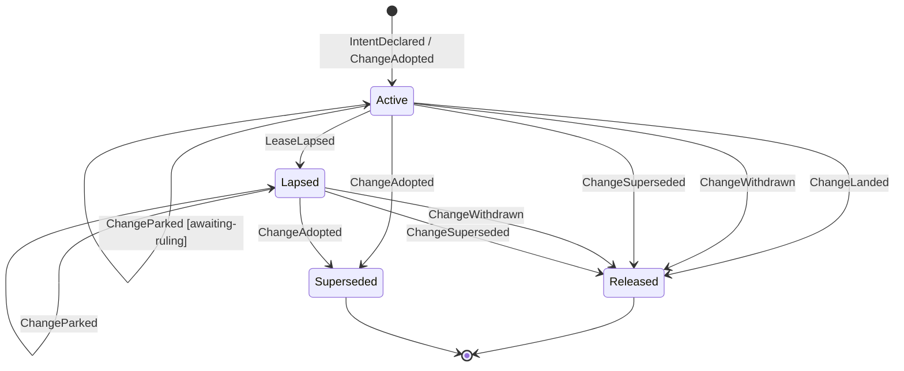
<!-- /chart:lease -->

| From | To | Trigger | Guard | Event |
|---|---|---|---|---|
| — | Active | `declare` or `adopt` | — | `IntentDeclared` / `ChangeAdopted` carry the `leaseId` |
| Active | Active | Any call on the change that carries this `leaseId` and passes the lease check, whether it is then accepted or refused | The lease is the change's, and not lapsed | none: `renewedAt` is state, not an event |
| Active | Active | The platform hands the change back to its agent (Bounced, Drifted) | — | `LeaseRestarted`: `renewedAt` is the hand-back's time |
| Active | Lapsed | The deadline alarm at `renewedAt + 15 min`, armed only while the change waits on its agent | No renewal or hand-back since | `LeaseLapsed` |
| Lapsed | Superseded | `adopt` by any agent with scope `agent:work` | — | `ChangeAdopted` (the new lease's token fences the old) |
| Active, Lapsed | Released | The change lands, is withdrawn or is superseded (e.g. an operator withdraws a parked change) | — | the change's terminal event |

**Terminal:** Released, Superseded.

**Invariants**
- Every mutating call on a change carries its `leaseId`; a call with a stale token is refused with next actions. "No lease" is never permission. Once the deadline passes, the current token is refused too (as lapsed, with adoption as the next action), whether or not the alarm has fired.
- Every refusal and every bounce carries at least one next action.
- Whether a lease has lapsed is computed on read, from `renewedAt`, the change's state and the time passed in; the alarm only makes the lapse visible as an event. It is a deadline, never a polling loop, and it is armed only while the lease is Active and the change waits on its agent.
- `renewedAt` is state the Change DO persists, not an event, so a replay rebuilds every other field exactly and gives the lease's issue time, or its last `LeaseRestarted`, as `renewedAt`.
- Adoption is a lease operation: it is allowed whenever the lease is Lapsed and the change waits on its agent, or is parked for the lapse. A lease lapses only while the change waits on its agent, so a change the platform holds cannot be adopted until it is handed back and 15 minutes pass.
- A lapse recorded while the platform held the change, under the rule before this one, does not stand: its holder's token still passes the lease check, nobody may adopt the change, and the hand-back's `LeaseRestarted` makes the same lease Active again. No one else can hold that lease, since an adoption issues a new one. The fold judges an adoption by the lease's own time rule, so a log decided under any rule of when a lease lapses still folds.

---

## Conflict

Owner: by kind. The Subject DO owns `semantic` and `precedent` conflicts. `textual` (a refused merge) and `interaction` (every subset of a batch passes, the union fails) conflicts have no subject, so the Lane DO owns them.

Footprint overlap is not a conflict: it is *exposure*, reported in preflight's neighbours. Proximity never opens a conflict.

<!-- chart:conflict — generated from packages/core/test/charts/charts.ts by render.ts; edit the chart, not this block -->
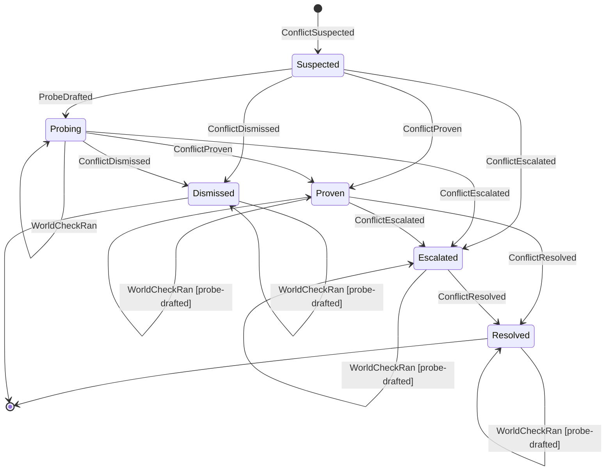
<!-- /chart:conflict -->

| From | To | Trigger | Guard | Event |
|---|---|---|---|---|
| — | Suspected | Fallout: a same-key contradiction with intersecting scope, or a silent retraction (semantic); a precedent's guard at risk (precedent); a refused merge (textual); a batch whose union fails while every subset passes (interaction) | Proximity alone never opens a conflict | `ConflictSuspected` |
| Suspected | Proven | Proof without a probe: a merge GitCore and MergeBox both refuse (textual), a failing guard (precedent), or a batch whose union fails while every subset passes (interaction) | The proof matches the kind | `ConflictProven` |
| Suspected | Dismissed | A deterministic lattice comparison shows the propositions are compatible (a ruling) | `decide` compares the premise and the effect itself: compatible or refines. Never for a conflict a decision model raised (`origin: opinion`), because a comparison over an opinion-derived effect is tainted, not a ruling | `ConflictDismissed` |
| Suspected | Probing | A probe compiles and runs | — | `ProbeDrafted` |
| Suspected | Escalated | Every draft fails (four at most), or the conflict names no premise and effect to probe: it is unprovable | The settle names the escalation it opened; without one it is refused (`escalation-required`). A settle that proves or dismisses needs none | `ProbeDiscarded {draft-failed}`, then `ConflictEscalated {reason: unprovable}` |
| Probing | Probing | One world-matrix cell completes | — | `ProbeRan` |
| Probing, or any state after it | The same state | A project suite's cell of the matrix (`suite:trunk` or `suite:<changeId>`, any world, run 1–3) completes. The suites are Tier 2 runs that finish minutes after the probe's deciding cell, so the cell is taken whatever the conflict has become since: Proven, Dismissed, Escalated or Resolved | The conflict's probe was drafted: before any draft, and on a conflict decided without a probe (a refused merge, a failing guard, a lattice ruling, drafts that all failed), it is refused (`no-probe-drafted`). The same cell again commits nothing; a different answer for it is refused; an n/a cell says why. It is evidence for people, never admission evidence: admission does not wait for it, and it never moves the conflict | `WorldCheckRan` |
| Probing | Proven | The probe discriminates | It passes on trunk (or does not apply), passes in the premise-holder's world, fails in the combined world and fails in A-noop, three runs in a row | `GuardAdmitted`, then `ConflictProven` |
| Probing | Dismissed | The probe gives the same answer in every world | — | `ProbeDiscarded {non-discriminating}`, then `ConflictDismissed` |
| Probing | Escalated | The probe is unstable across runs, or its run ended before the matrix was complete | The settle names the escalation it opened, as above | `ProbeDiscarded {unstable}` or `ProbeDiscarded {run-failed}`, then `ConflictEscalated {reason: unprovable}` |
| Proven | Escalated | The conflict is human-class | Permission semantics, destructive migrations, ambiguous requirements | `ConflictEscalated {reason: human-class}` |
| Proven | Resolved | A ruling is applied (`escalate`, then the person's decision) | — | `ConflictResolved` |
| Escalated | Resolved | Caused by `RulingGiven` | A Decision: an escalated conflict resolves only on a ruling. A ruling that lets one side stand goes against the other: the premise standing against the change making the effect, the effect standing against the premise's holder. `against` is taken only with a decision and only of the conflict's parties (`not-a-party`) | `ConflictResolved` (with `decisionId`, and with `against` when the ruling goes against a party; one that favours no side names none, and every party resumes) |

**Terminal:** Resolved, Dismissed. A terminal conflict whose probe was drafted still records a late suite cell: a fact that leaves it where it ended.

**Invariants**
- Only proof or a ruling moves a conflict to Proven or Dismissed. An unprovable conflict is opinion, and it escalates rather than blocking.
- A dismissal is recorded as evidence, so the same alarm is not raised again on the same facts.

---

## Probe → Guard

Owner: the DO that owns the probe's conflict. If a probe proves the disagreement it is admitted as a Guard in the guard repo, which agents cannot write to.

**A probe entity begins with its first event:** `ProbeDrafted` (a draft compiled and ran) or `ProbeDiscarded {draft-failed}` (every draft failed). Drafting and its bounded repair loop (≤ 4 attempts: the first draft and three repairs, driven by deterministic error text) are a phase inside one Workflow step, not a persisted state, so replay rebuilds a probe exactly from its events.

<!-- chart:probe — generated from packages/core/test/charts/charts.ts by render.ts; edit the chart, not this block -->
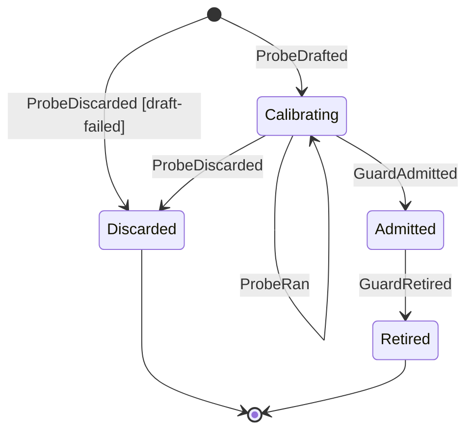
<!-- /chart:probe -->

| From | To | Trigger | Guard | Event |
|---|---|---|---|---|
| — | Calibrating | A draft compiles and runs | Attempts ≤ 4; the conflict names the premise at stake and the effect against it (else refused `no-propositions`: a probe is never guessed, so the drafter reports the draft failed) | `ProbeDrafted` |
| — | Discarded | Every draft failed, or there was nothing to draft against | — | `ProbeDiscarded {reason: draft-failed}` |
| Calibrating | Calibrating | One world-matrix cell (trunk, A, B, AB or A-noop; run 1–3) completes | Its conflict is Probing it. The same cell again is a retry and commits nothing; a different answer for it is refused | `ProbeRan` |
| Calibrating | Admitted | Computed from the `ProbeRan` cells | Passes on trunk (or does not apply), passes in the premise-holder's world, fails in the combined world, **fails in A-noop**, stable over 3 runs | `GuardAdmitted` |
| Calibrating | Discarded | Not discriminating, or unstable | — | `ProbeDiscarded` |
| Calibrating | Discarded | The probe's run ends, for any cause, before its matrix is complete: its Workflow or a world died after the draft was recorded, or every cell the run had is recorded and fewer than three runs are complete. The machine cannot tell that no more cells are coming, so its caller reports the run as failed | Its conflict is Probing it. The cells recorded so far stay on the probe; they decided nothing, and no guard is admitted | `ProbeDiscarded {reason: run-failed}` |
| Admitted | Retired | A superseding Decision | — | `GuardRetired` |

**Terminal:** Discarded, Retired. (An admitted Guard stays Admitted, guarding trunk, until a Decision retires it.)

**A-noop** is the premise-holder's world with the premised behaviour removed: for S-1's freshness template, a revoke route that answers 204 and removes nothing. The probe's template supplies the recipe for building it, and the world matrix builds it. A probe that passes there, or does not apply there, never tested the premise (spike S26 found one that only counted store lookups), so it is non-discriminating. A probe whose recipe cannot build an A-noop world never completes a run, so it is never admitted, and its conflict escalates as unprovable rather than resting on a possibly vacuous probe.

**Invariants**
- A drafted probe is opinion until it discriminates.
- Only guards block on behalf of past decisions; a change whose diff touches guard paths is refused at Precheck.
- A guard that turns unstable on trunk is escalated to a person, never quarantined automatically: protected checks are human-class.

---

## Candidate

Owner: Lane DO. A **Batch** is a set of Changes verified together; its **Candidate** is the tree composed for one attempt. They are one-to-one per attempt, so the batch events are the candidate's transitions. Promotion onto trunk belongs to the Trunk DO (below).

<!-- chart:candidate — generated from packages/core/test/charts/charts.ts by render.ts; edit the chart, not this block -->
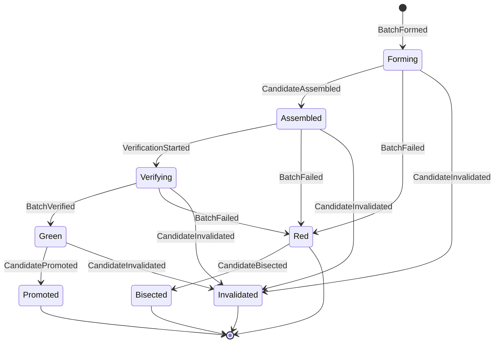
<!-- /chart:candidate -->

| From | To | Trigger | Guard | Event |
|---|---|---|---|---|
| — | Forming | The lane forms a batch | N = min(the project's `maxBatchSize`, clamp(ln 0.8 / ln(1−p), 1, 16)), p the share of failures among the lane's last 20 member outcomes; the queue's head first, then members in queue order; no two members that share a conflict neither dismissed nor resolved, or with opposite effects on one subject; risky changes alone (a person's plan, or requeued `textual` or `interaction`); members whose plans union, and the union stored as the batch's plan. While the batch in flight verifies and a KeelVerify box is free, the lane forms the next batch behind the last, on its candidate, with every member ahead as its predecessors | `BatchFormed` |
| Forming | Assembled | GitCore composes the tree (Tier 0), or MergeBox when GitCore refuses (Tier 2) | — | `CandidateAssembled` (with tier and reason) |
| Forming | Red | GitCore and MergeBox both refuse to compose | — | `BatchFailed`: for a batch of one, attributed to its member, so the change bounces with next actions; for a larger batch, `textual`: every member requeues and runs alone next, and the Lane opens no Conflict for it (a proven one would bounce the innocent member too) |
| Forming | Red | MergeBox cannot compose for its own sake: BoxGate has no room, the box could not fetch, push or answer, or its check of the box did not pass | — | `BatchFailed` attributed to `infra`, and the verdict holds: every member requeues. A batch of one refused that way the third time in a row is attributed to its member instead, and bounces with the reasons and a next action to submit again unchanged. In a batch of several every member counts the failure, and one that reaches the third runs alone next |
| Forming | Red | BoxGate refuses because the namespace's verification spend is halted | — | `BatchFailed` attributed to `halted`: every member bounces once, blamed on none and counted by none, with the owner's next action to ask for a resume |
| Assembled | Verifying | KeelVerify instance created | — | `VerificationStarted` |
| Verifying | Verifying | KeelVerify reports a step of the plan starting, or its result | Fenced on `(batchId, attempt, chainEpoch)`; refused once the batch has left Verifying | `VerificationStepStarted` or `VerificationStepFinished`; the batch stays as it is |
| Assembled | Red | The candidate cannot be bundled (a symlink, a gitlink, an unsafe path) | The blame is a member (the one whose restacked commit introduces the entry) or `infra` (the base already holds it) | `BatchFailed` with that attribution; never bisected |
| Verifying | Green | The union of the members' plans passes | Results fenced on `(batchId, attempt, chainEpoch)`: a result for another attempt or epoch is refused and never retried. No step the project's shrink rule watches passed fewer tests than trunk's last verdict, less the drop a maintainer accepted for a member | `BatchVerified` (with the members, base and predecessors the Trunk DO needs) |
| Verifying | Red | The union passes, but a step the shrink rule watches passed fewer tests than trunk's last verdict allows | Fenced as above. `shrink` only for a batch of one | `VerdictIssued {outcome: park}` citing each step's count against trunk's, then `BatchFailed`: for a batch of one attributed to `shrink`, after the lane has put the drop to the project's maintainers, so its member parks on that question; for several `unattributed`, so each forms its next batch alone and the question is asked of the change that dropped them. Neither counts as a pass or a fail |
| Verifying | Red | A step fails after a flake rerun | Fenced as above; a blamed change is a member; `interaction` and `unattributed` need several members (a batch of one's failure is its member's) | `BatchFailed` (attribution: a change, `interaction`, `infra`, or `unattributed` when several members could be to blame; `halted` when KeelVerify ran nothing because the namespace is halted, which bounces every member once, blamed on none) |
| Red | Bisected | More than one member, and the failure is `unattributed` | — | `CandidateBisected` (new batches): today one a member, and each member forms its next batch alone under the id that named it |
| Green | Promoted | Caused by `TrunkAdvanced` | — | `CandidatePromoted` |
| Green | Invalidated | Caused by `PromotionDeclined`: trunk moved and the commutation rule fails | — | `CandidateInvalidated` |
| Forming, Assembled, Verifying or Green | Invalidated | The lane cancels a batch it speculated behind another, when a batch ahead of it fails, or its own step fails before it is in flight | Only a batch behind the one in flight: its verdict is kept until every batch ahead has landed, so trunk is never offered it | `CandidateInvalidated {reason: cancelled, because}`, naming the batch whose failure undid it; every member requeues (`ChangeRequeued {reason: invalidated}`) and forms again on trunk's head, blamed for nothing |

**Terminal:** Promoted, Invalidated, Bisected, Red (unless it is `unattributed` with several members, which is bisected).

**The shrink rule.** A project's `.keel/flow.json` sets `shrink` to `park` (the default) or `off`, read at the change's base like the rest of its flow. While it parks, the compiler marks every step whose tests Keel can count (`counted`): a suite the verifier pack runs, and a command of the project's that names a JUnit report. A pass of such a step counts the tests that passed; one whose report was not written, or does not read, counts none. KeelVerify's land carries those counts to the lane, which holds them to trunk's last verdict: the counts of the last batch trunk took that ran the step, kept when trunk's `TrunkAdvanced` names the batch's own candidate. A step trunk has no count for yet is held to nothing. In an agent's own namespace no person can rule, so a batch of one that drops tests bounces its change instead (`BatchFailed` blaming it, with the next action to restore the tests), and nobody is asked. A maintainer's approve of a drop lets the change's batches pass that many fewer, and no more; the drop is forgotten once the change lands, ends or is submitted again. The project's `humanClassPaths`, in the same file, add globs to Keel's own human-class paths (`.keel/flow*`, `.keel/flow/**`, `.keel/plugins/**`), which it cannot drop: a change touching any of them parks for a person's ruling as it is queued, and the question names the paths.

**Invariants**
- An interaction failure (every subset passes, the union fails) opens an `interaction` conflict owned by the Lane DO.
- Every step records its tier and the reason it was chosen. An escalation to a higher tier is sticky and visible.

### Promotion (Trunk DO)

Owner: Trunk DO (`trunk:<project>`), the one writer of trunk ([ADR 0003](../adr/0003-trunk-single-writer-wal.md)).

<!-- chart:promotion — generated from packages/core/test/charts/charts.ts by render.ts; edit the chart, not this block -->
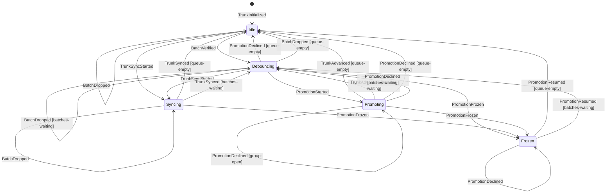
<!-- /chart:promotion -->

The Trunk DO's state is folded from its own events and from the `BatchVerified` it receives, recorded in the same transaction as its reaction ([ADR 0009](../adr/0009-event-driven-outbox.md)), so replaying both in commit order rebuilds it.

| From | To | Trigger | Guard | Event |
|---|---|---|---|---|
| — | Idle | The project's seed, or an operator, names trunk's first head | — | `TrunkInitialized {head}`. Before it, nothing is queued or promoted (refused: not initialized) |
| Idle | Debouncing | A `BatchVerified` arrives | — | the received `BatchVerified` is recorded; the debounce alarm is armed (a named debounce). In any other phase the batch only queues |
| Debouncing | Promoting | The debounce deadline fires | The observed head is trunk's known head; queued batches are taken first in, first out: one that commutes (C1–C6) joins the group, one that does not is declined, one that must wait stops the queue there | `PromotionDeclined` for each declined batch, then `PromotionStarted {old, members, batches, proofIds, committerTime}`: the WAL entry |
| Debouncing | Idle, or Debouncing | The commutation rule admits no batch | — | `PromotionDeclined` for each declined batch; Debouncing again while batches still wait |
| Debouncing | Frozen | The observed head is not trunk's known head | — | `PromotionFrozen {reason: head-moved}` |
| Promoting | Promoting | The group is composed, before the first push | The composer's chain names exactly the group's members, in group order (otherwise refused: composition mismatch) | `PromotionComposed {sha, commits}`: every retry pushes this SHA, and each member lands as its commit in `commits` |
| Promoting | Promoting | Read-back shows the head is still `old` | — | none: the push is retried with the recorded SHA. A recompose that differs from it is never pushed: `PromotionFrozen {reason: recompose-mismatch}` |
| Promoting | Idle, or Debouncing | Read-back shows the head is the recorded SHA | — | `TrunkAdvanced {landings}`: one per member, in group order, with its commit on trunk and its own batch's candidate and proof; Debouncing again if batches arrived meanwhile |
| Promoting | Frozen | Read-back shows any other head | — | `PromotionFrozen {reason: readback-mismatch}` |
| Promoting | Idle, or Debouncing | Artifacts refuses the group's push, or the composed pack would take the repo past its quota | The group is composed, and the head is still `old` (a push that may have landed is read back instead) | `PromotionDeclined {reason: pack-too-large or repo-bytes-quota, nextActions}` for each batch of the group, the last ending it; trunk does not move and never freezes. A batch refused alone as too large, and every batch of a full repo, has `reverify` empty: its members bounce. A group of several refused as too large names each batch's members in `reverify`, and from then on each group is one batch, until a push lands |
| Frozen | Idle, or Debouncing | An operator releases the freeze, confirming trunk's head | Scope `operator` | `PromotionDeclined {reason: frozen}` for each batch of the stopped group, then `PromotionResumed {head}` |
| Any | The same, or Idle | The Lane cancels a batch speculation verified behind a failed one | The batch is not in the group being pushed and none of its members landed (otherwise refused as too late) | `BatchDropped {batchId, because}`: the batch leaves the queue, Idle when it leaves a debounce with none, or is remembered before its verdict arrives. A batch dropped already is answered the same again, with nothing recorded |
| Idle, or Debouncing | Syncing | An owner syncs an imported or forked trunk from its upstream | Trunk's head is `from`; for an import, upstream's branch head descends from it (refused 409 `trunk.not_fast_forward` otherwise); for a fork, upstream's trunk head is taken as it is when the fork holds nothing of its own since it last met upstream, and otherwise Keel merges it on that point into one commit it signs, with the fork's head and upstream's as its parents (refused 409 `trunk.sync_conflicts`, naming the first path both changed apart, with nothing moved). Either way the new history is admitted against the namespace's repo bytes first | `TrunkSyncStarted {from, to, upstream, merged?}`: the WAL entry of the move (`groupId` `sync:<to>`) |
| Syncing | Syncing | A `BatchVerified` arrives, or a batch is dropped | — | the batch only queues: no group starts while a sync is open |
| Syncing | Idle, or Debouncing | Read-back shows the head is `to` | — | `TrunkSynced {from, to, upstream, merged?, height}`; a fork's trunk remembers it as a point where it met upstream (`to`, and the upstream head it took), newest first |
| Syncing | Frozen | Read-back shows any other head | — | `PromotionFrozen {reason: readback-mismatch}` |

The Auditor's full-suite run on each new head is recorded as `AuditCompleted`. On red it bisects across commutation-promoted commits and declares a revert change with `origin: auditor`, which lands like any other change.

**Invariants**
- A retry pushes the SHA recorded in `PromotionComposed`, never a recompose: compose is deterministic only within one code version, and a Durable Object can run the previous version for minutes after a deploy.
- Every WAL group ends exactly once, in `TrunkAdvanced` or `PromotionFrozen`. Nothing promotes from Frozen until `PromotionResumed`.
- A dropped batch never promotes: a `BatchVerified` for it is refused however late it arrives, so its members, queued again, land once.
- Artifacts' own compare-and-swap, if it exists, is a second fence and never the only one.
- A sync never rewrites trunk: it moves main forward to upstream's head or to Keel's merge of it, whose first parent is trunk's head. A fork remembers at most 32 of its syncs; a proposal from it is based on the newest one its commit holds, or on the fork point.

---

## Escalation

Owner: the object of the namespace that owns the project the question is about (`ns:<namespaceId>`), whoever raised it. Its id is derived from what it is about, so the same question raised again (a retry, the other party) is the same escalation. An Escalation is a question routed to a person, with options and their consequences.

<!-- chart:escalation — generated from packages/core/test/charts/charts.ts by render.ts; edit the chart, not this block -->
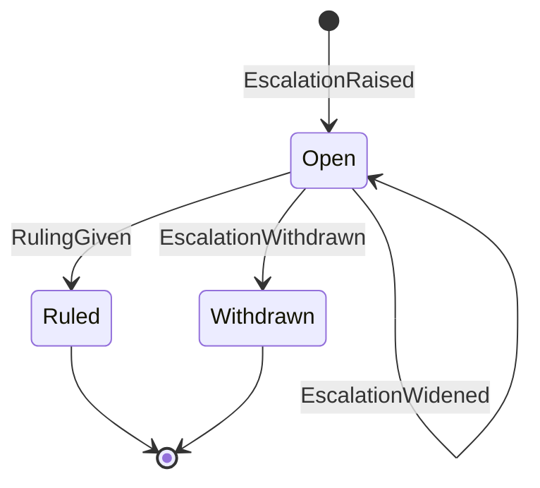
<!-- /chart:escalation -->

| From | To | Trigger | Guard | Event |
|---|---|---|---|---|
| — | Open | A human-class conflict or step, an unprovable conflict, an overrule request, a frozen trunk | At least two options with unique ids, and the default among them (otherwise invalid) | `EscalationRaised` |
| Open | Ruled | A person answers | Scope `operator`; the option is one the escalation offers (otherwise refused, with a next action per valid id) | `RulingGiven`, emitted by the owner, with the `DecisionRecorded` it makes in the same transaction. The object that raised the escalation hears the decision and acts on it (a conflict resolves with it, and its parked parties resume) |
| Open | Withdrawn | Its subject was resolved some other way | — | `EscalationWithdrawn` |
| Open | Open | The user asked first has had thirty minutes (the owner's own deadline) | Not widened before: a second widening commits nothing | `EscalationWidened`: the namespace's maintainers are asked too. The escalation records when (`widenedAt`); who may answer does not change |

**Terminal:** Ruled, Withdrawn: a second ruling, even an identical one, is refused (the doorway's idempotency key covers retries), and neither is widened. While Open the owner holds; the default is only a suggestion and is never applied on a timeout. A ruling produces a Decision.

---

## Decision

Owner: Subject DO. A Decision is a recorded ruling. Later changes meet it as a Precedent and record a Stance.

<!-- chart:decision — generated from packages/core/test/charts/charts.ts by render.ts; edit the chart, not this block -->
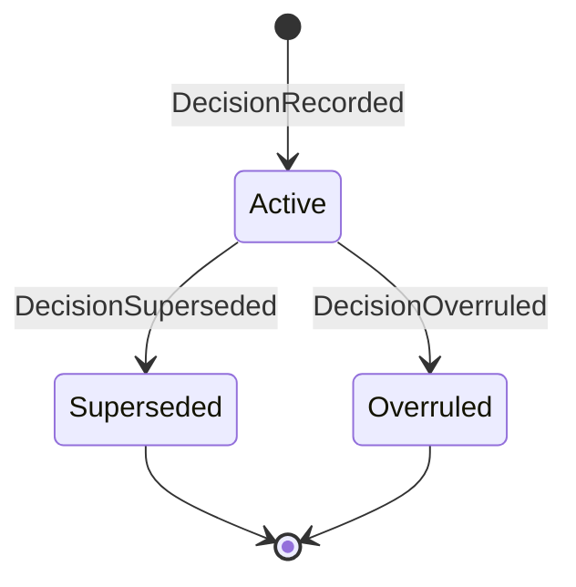
<!-- /chart:decision -->

| From | To | Trigger | Guard | Event |
|---|---|---|---|---|
| — | Active | Caused by `RulingGiven` on an escalation | The escalation is ruled | `DecisionRecorded`: the option chosen, and every other option as a rejected alternative |
| Active | Superseded | A later decision with the same or wider scope | `scopeCovers(new, old)` in the proposition scope grammar; an absent scope is everywhere | `DecisionSuperseded` |
| Active | Overruled | `OverruleRequested`, escalated, and ruled in favour | The escalation is ruled `overrule`, and its category is `overrule-request` | `DecisionOverruled` |

**Stances** do not change a Decision's state; each is a fact about a change: `PrecedentSurfaced` (preflight showed it), then `PrecedentFollowed`, `PrecedentDistinguished` or `OverruleRequested`.

**As a precedent:** only an Active decision is one. `scopedPrecedent(decision, upheld)` gives preflight the decision's id, summary, date and scope with the propositions it upheld, and nothing once the decision is Superseded or Overruled: it is then neither listed nor contradicted, and the decision that ended it brings only what it upheld itself. What a decision upheld is `holds(sides, against)`, read from the conflict it ruled: the side its ruling did not go against (the premise when only the effect's change lost, the effect when only the premise's holder lost), and nothing typed when the ruling went against neither side or both, or the conflict does not name two sides. A decision that upheld nothing typed can be followed and never contradicted.

**Terminal:** Superseded, Overruled.

**Invariant:** a precedent never blocks by itself; only guards do. A Decision carries its date, scope, evidence and the alternatives it rejected.

---

## Tenet

Owner: Subject DO. A Tenet is a belief trunk currently holds: an effect that has landed and is backed by at least one guard.

<!-- chart:tenet — generated from packages/core/test/charts/charts.ts by render.ts; edit the chart, not this block -->
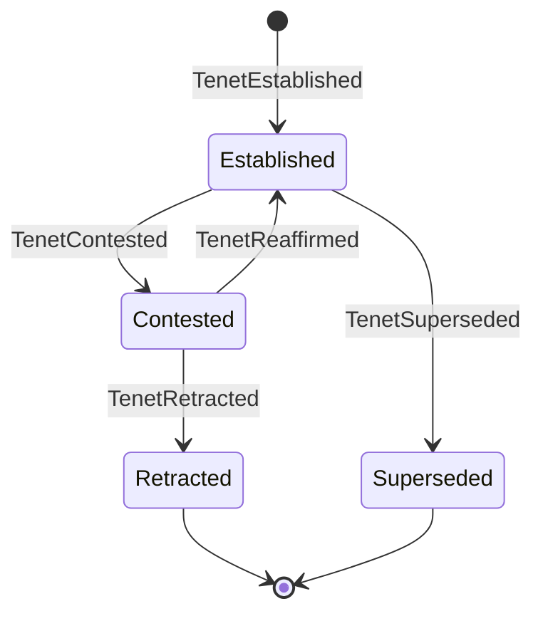
<!-- /chart:tenet -->

| From | To | Trigger | Guard | Event |
|---|---|---|---|---|
| — | Established | Caused by `ChangeLanded` | The landed effect is backed by at least one admitted guard (otherwise refused, `unguarded`) | `TenetEstablished` |
| Established | Contested | A change's effect contradicts the tenet | The conflict is open (suspected, probing, proven or escalated) and names the tenet as a party | `ConflictSuspected` (tenet as party), then `TenetContested` |
| Contested | Established | The contesting conflict is dismissed, or resolved by `distinguish` | Any other state or move is refused (`conflict-unsettled`) | `TenetReaffirmed` |
| Contested | Retracted | A change lands against the tenet, on a ruling | A `decisionId`, under any policy | `TenetRetracted` (with `decisionId`) |
| Contested | Retracted | A change lands against the tenet, on proof, where the predicate's policy is `advise` or `annotate` (absent is `advise`) | The contesting conflict is `proven` and the landing change is a party; under `block` a ruling is required (`ruling-required`); opinion never retracts (`not-proven`) | `TenetRetracted` (citing the conflict) |
| Established | Superseded | A new tenet on the same `(subject, predicate)` replaces it | — | `TenetSuperseded` |

**Terminal:** Retracted, Superseded.

**Policy** (ADR 0005): a project composes its predicate policy per change, like flows, and chooses per predicate whether a proven conflict `block`s, `advise`s or `annotate`s; the default is `advise`. Only retraction reads it: under `block` the challenger waits for a ruling, so a tenet leaves Contested only by a ruling or by being reaffirmed; under `advise` or `annotate` the challenger may land, so trunk no longer holds the belief and the proof retracts it, citing the conflict. A tenet never blocks by itself.

**Invariant:** new code that calls a symbol carrying a tenet is subscribed to that tenet automatically (an implied premise).

---

## Agent

Owner: AgentSession DO. An agent is made one of two ways: it signs itself up with a key (`AgentSignedUp`: its id and handle are made from the key, and it has no project and no kind), or a person enrols it in a project (`AgentEnrolled`: kinds interactive, hosted, human, synthetic). Signing up again with the same key commits nothing; another key never joins an agent that way.

<!-- chart:agent — generated from packages/core/test/charts/charts.ts by render.ts; edit the chart, not this block -->
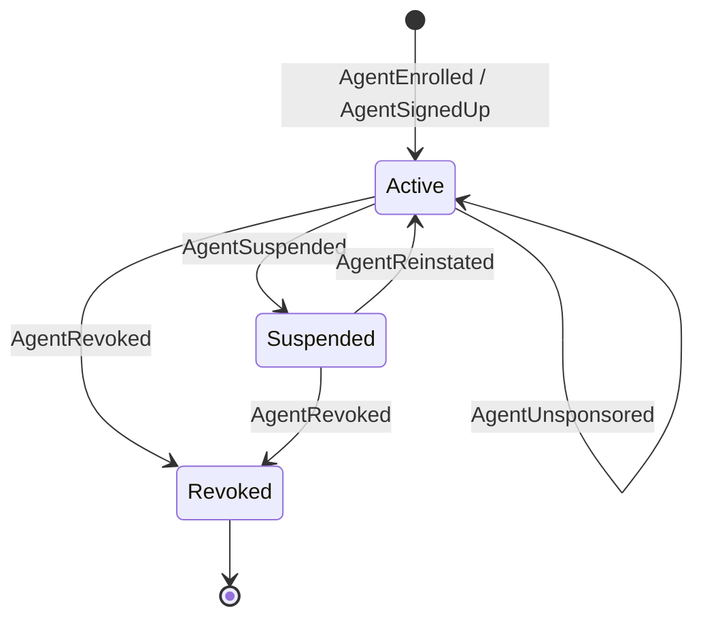
<!-- /chart:agent -->

**Terminal:** Revoked. Revocation bumps the agent's revocation epoch by exactly one (an agent enrols at epoch 0), so every token minted before it fails verification. A suspended agent's tokens fail too, until it is reinstated.

**The sponsor link.** A person sponsors an agent: `Sponsor` commits `AgentSponsored`, and `EndSponsorship` commits `AgentUnsponsored`. An agent has at most one sponsor: the same person sponsoring again commits nothing, and another is refused until the first has switched the link off. The link carries no rights. Only its two parties end it, the sponsor or the agent itself; anyone else is refused as no party to it, and the event names which of the two it was. A revoked agent takes neither command and keeps the record of who sponsored it.

**A pause holds.** A suspended agent becomes active again by a reinstatement, or by its sponsor ending the link: that commits `AgentReinstated` first, since nobody else could reinstate it. Nothing else lifts a pause. The agent cannot leave its sponsor while it is paused, and nobody becomes the sponsor of a paused agent, so a person who was not behind the agent when it was paused never lifts the pause by leaving. Both are refused with the reason that the agent is paused.

**Invariant:** declaration fidelity routes review; it never judges the agent.

---

## Invitation

Owner: the object of the place the invitation is to, one row an agent. **Into an org:** the namespace's own object (`ns:<id>`), on the namespace's entity `org:<namespaceId>`. An agent is invited into an org by a member and stands there once it accepts (`read` and `work`, never more). A person's own namespace and an agent's own take no invitation into the whole of them: the policy asks it of an org alone. **To one project of a person's own namespace:** the Project DO (`project:<id>`), on the project's own entity, so its events carry the project. The person invites the agent to that project as a personal repository takes a collaborator, and it stands on that project and on nothing else of the namespace. An org's project and an agent's take no such invitation: the policy asks it of a person's own project alone.

One machine decides both. Its facts name the namespace and, for a project, the project; the rules, the refusals and the reasons of an end are the same, and only the events' names differ.

<!-- chart:invitation — generated from packages/core/test/charts/charts.ts by render.ts; edit the chart, not this block -->
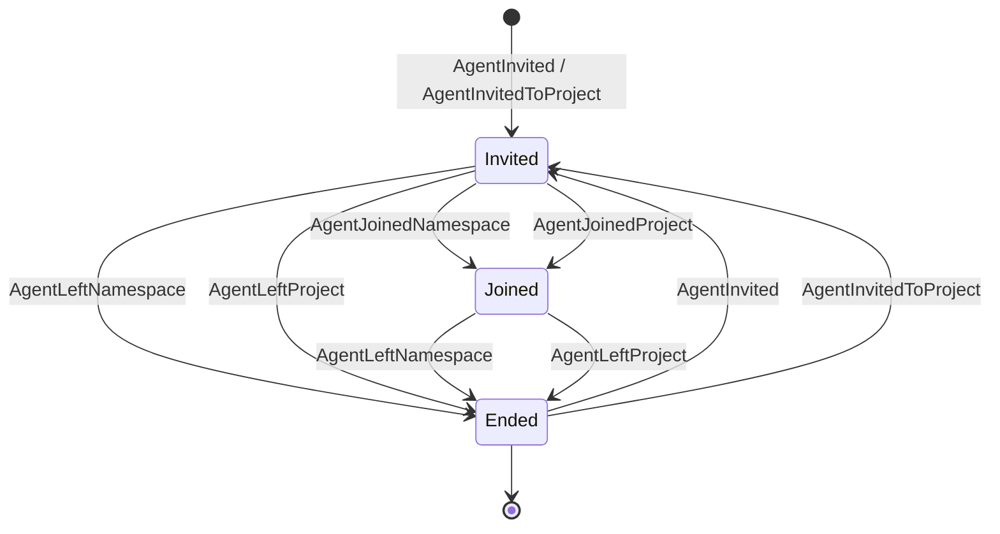
<!-- /chart:invitation -->

| From | Command | Event | To |
|---|---|---|---|
| none, Ended | `Invite {by, scopes}` | `AgentInvited` | Invited |
| Invited | `Accept` | `AgentJoinedNamespace` | Joined |
| Invited | `End` by the agent | `AgentLeftNamespace {reason: declined}` | Ended |
| Invited | `End` by the member who invited it | `AgentLeftNamespace {reason: withdrawn}` | Ended |
| Invited | `End` by another person | `AgentLeftNamespace {reason: removed}` | Ended |
| Joined | `End` by the agent | `AgentLeftNamespace {reason: left}` | Ended |
| Joined | `End` by a person | `AgentLeftNamespace {reason: removed}` | Ended |

With a project in the facts, the same rows commit `AgentInvitedToProject`, `AgentJoinedProject` and `AgentLeftProject`, each naming the project and its namespace. A row takes the events of its own place and no other's: a project's event on a namespace's row, a namespace's on a project's, or another project's, is refused by the fold.

**One member answers for an agent in a namespace.** While an invitation stands, pending or accepted, the same member inviting again for the same scopes commits nothing, and anything else is refused (`already-invited`) until it has ended. Only an invited agent accepts (`not-invited` otherwise), and accepting again commits nothing. Another agent is no party to an invitation (`not-a-party`). Whether a person may invite or end is the policy's to decide before the machine: in an org any member invites, and the member who invited the agent, a maintainer or an owner ends; on a person's own project that person does both. It is a person's act in either place: the invitation names the person who answers for the agent, so no agent invites one or takes one out, wherever it governs. An invitation that would give anything but read, or read and work, each once, is refused by name (`invalid-scopes`) wherever the row stands.

**The row is the one its facts name.** The machine is handed the row and, apart from it, the namespace, the agent and the project the command is about. A row of another agent, of another namespace or of another place in it is the caller's defect and no refusal: the decision throws, as the fold does on such an event, and nothing is committed. The fold reads an end by its event's kind alone: whatever reason it carries, it ends an invitation that stands.

**Only an accepted invitation gives standing.** The request gate reads the invitation's row in D1 (`namespace_agents`) on every request of an agent in a namespace that is not its own: `joined` makes it `Invited` by the standing its inviter holds now, with its token's scopes cut to the invitation's. So an inviter who leaves the org takes the agent's rights with them at once, with no write. For now the row stays `joined` and no event says the membership ended: the inviter's leaving will end the invitation with an event of its own (`inviterLeft`). An ended invitation keeps its row as `ended`, and the agent may be invited again. An invitation to one project is read the same way from `project_agents`, by the project the token names: `joined` makes the agent `Invited` by the standing of the person who invited it, who owns the namespace for as long as their account stands, and marks the standing as that project's alone (`projectOnly`), so another private project of the namespace is not there for the agent.

**Who is asked first.** A question about the work of an agent that has joined a namespace goes first to the member who invited it there, whoever sponsors the agent. The namespace's object reads its own row when it raises the escalation. Outside an org it reads the row of the escalation's own project in `project_agents`: the person who invited the agent to that project is asked first about it, and about another of their projects the invitation says nothing.

---

## Issue

Owner: the Project DO (`project:<id>`), on the project's own entity, so an issue's events carry the project. An issue is something someone asked of the project, apart from any change. Its `#n` comes from the Projector before it is opened, from the sequence the project's changes share (`IssueNumbers`), so a number names one thing in a project; a retry with the same key finds the number its first try was given and asks for none.

| From | Command | Event | To |
|---|---|---|---|
| none | `Open {title, body, author}` | `IssueOpened` | Open |
| Open, Closed | `Comment {commentId, body, author}` | `IssueCommented` | as it was |
| Open | `Close {reason, by}` | `IssueClosed {reason, by}` | Closed |
| Open | `CloseByChange {changeId}` | `IssueClosed {reason: completed, byChange}` | Closed |
| Closed | `Reopen {by}` | `IssueReopened` | Open |

Opening an issue that stands, closing a closed one and reopening an open one commit nothing, so two people who press at once both see it done. A command on an issue never opened is the caller's mistake (the use-case answers `IssueNotFound` first) and throws, as the fold does on an event its state cannot take. Who may give each command is the policy's to decide before the machine ([tenancy.md](tenancy.md)).

**A landing closes the issues its change names.** The Project DO hears each of its changes' intents for its live-change index. When a change lands, before the index forgets it, the goal it declared or revised to is read for GitHub's closing keywords ("Fixes #12", "closes #3", "Resolved #45": the nine forms, any case, an optional colon), and each open issue it names is closed as `completed`, by the change, in the transaction that heard the landing. A number the project has no issue of, or one of its changes, closes nothing.

---

## Workspace

Owner: WorkspacePool DO. A Workspace is the throwaway Artifacts repo a Change is worked in.

<!-- chart:workspace — generated from packages/core/test/charts/charts.ts by render.ts; edit the chart, not this block -->
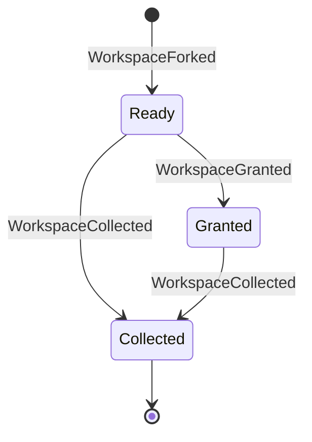
<!-- /chart:workspace -->

**Terminal:** Collected.

**Invariants**
- A ready workspace is granted exactly once, to a change. A repeated grant to the same holder is a no-op (the pool mints that retry a fresh token), one to another holder is refused, and collecting a collected workspace again is a no-op.
- The pool's own slots also pass through `forking` (before `WorkspaceForked`, so not yet a workspace) and `collecting` (the repo's deletion in progress, still Collected here).
- A fork is ready when the pool's own fork call resolves (spike S2); nothing polls for it.

---

## Deployment (deferred)

Owner: the DO that created it. The machine is fixed when the `Deployer` adapters land:

- preview: Previewing → Live → TornDown (`PreviewDeployed`, `PreviewTornDown`);
- promotion: Promoting, through the target's stages (e.g. 10% → 100%) → Promoted | RolledBack (`DeploymentPromoted`, `DeploymentRolledBack`).

### Deploy targets

Owner: the Project DO. A project holds up to 16 deploy targets, one a name, and each is a record: the name a repo's `.keel/deploy` gives, the provider, the account there and the id of a credential in the org's store. It has no states, only what is set: two decisions and a fold, in `domain/delivery/deploy-target.ts`.

- **Set** commits `DeployTargetSet` with the whole record, new or in place of the one of that name. It is refused when the credential is not in the project's own org (the caller reads that from the org's credential store and passes it as a fact), so no project deploys with another org's secret, and when the name would be a seventeenth. Setting a target to exactly what it is commits nothing.
- **Clear** commits `DeployTargetCleared`; a name that is not set is refused.
- The fold keeps one record a name, in name order. Resolving a name gives the whole record as it stands, which is what the Deployer's plan step takes: a plan keeps the account and the credential reference it was made with, whatever is set afterwards.
- The record names a credential and never holds one: the credential's id is minted when a secret is stored, so nothing a person types fits the field. Only an owner of the project's org sets or clears a target, and only an owner of an org touches its credentials.
